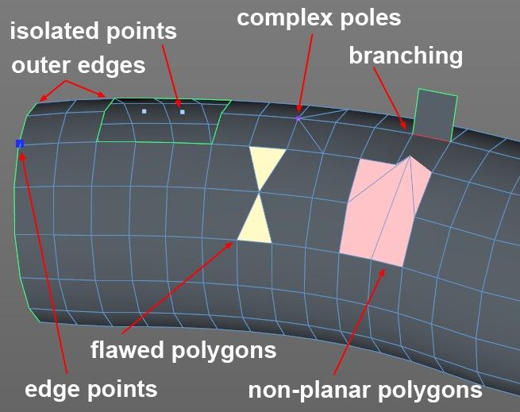
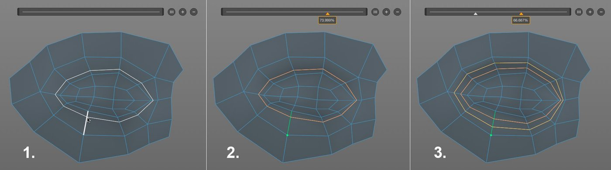
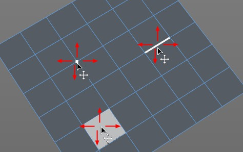
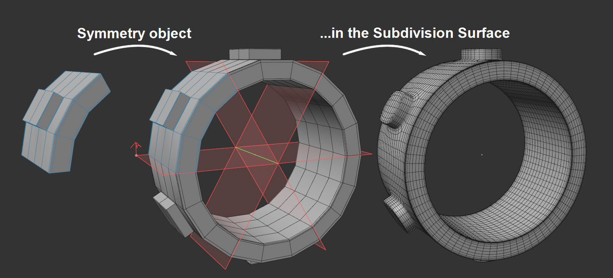
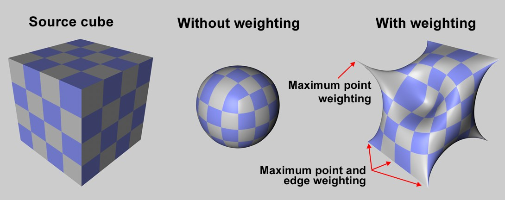
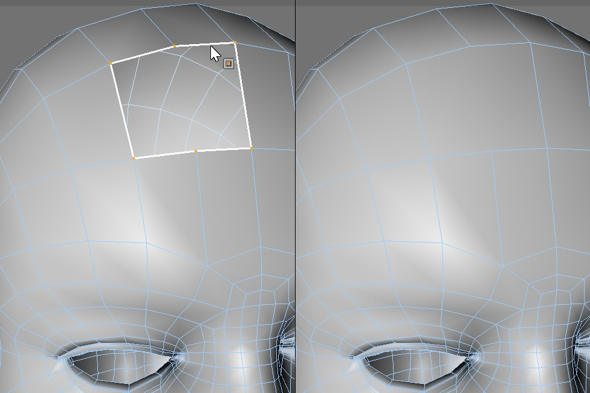
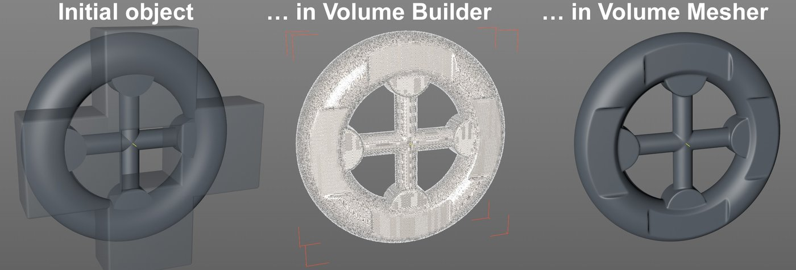
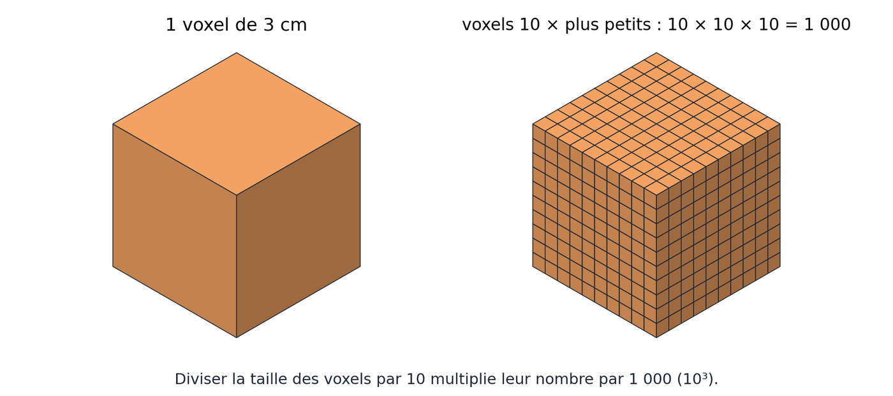
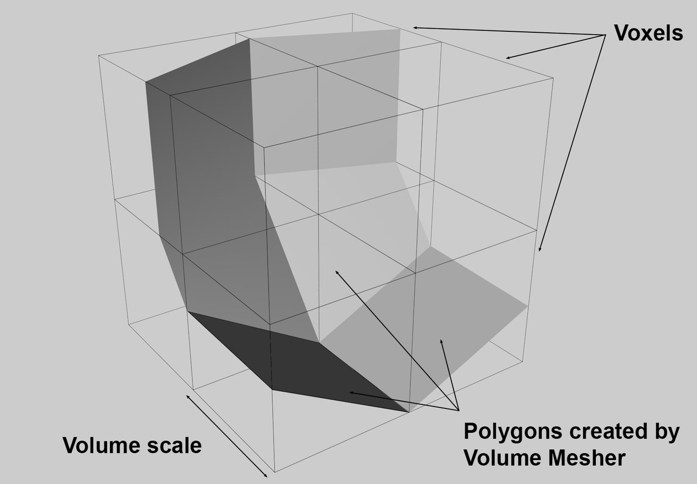

# Jour 4 – Outils de modélisation, topologie et modélisation en volume

## Objectifs du jour

- Diagnostiquer un maillage avec la Vérification du maillage.
- Sélectionner précisément avec les outils de sélection.
- Maîtriser la boîte à outils de modélisation polygonale.
- Modéliser un cœur et une cuillère.
- Découvrir la modélisation en volume (voxels) et refaire la tasse en quelques minutes.

## Topologie : bien, mal, très mal (Mesh Checking)

La **Vérification du maillage (Mesh Checking)** se trouve dans le Gestionnaire d'attributs > Mode > Modélisation. Elle colore les défauts du maillage. On les classe en trois catégories.

{: .w60}
*Défauts signalés par la Vérification du maillage : points isolés, bords ouverts, pôles complexes, ramifications (non-manifold), polygones défectueux ou non plans. — Source : aide officielle Cinema 4D (Maxon), page [Mesh Checking](https://help.maxon.net/c4d/en-us/Content/html/DMODELING-MESH_CHECK.html)*

- **Le bon (The Good)** : quads réguliers. Lissage optimal, flux d'arêtes naturel, compatible avec la sélection en boucle et la coupe en boucle.
- **Le mauvais (The Bad)** : triangles, N-Gons, pôles complexes, polygones coplanaires. Pincements au lissage, déformations imprévisibles. Tolérables sur des surfaces planes non déformées.
- **Le très mauvais (The Ugly)** : non-manifold (arête partagée par plus de 2 faces, face interne flottante), mauvais polygones, points isolés. Rendu cassé (verre, SSS, occlusion ambiante), outils qui échouent (biseau, extrusion).

**Règles pratiques**

- Mieux vaut un ou deux triangles, ou un N-Gon de 5-6 côtés sur une zone plate, que de grands quads très irréguliers partout.
- Une topologie médiocre sur une surface plane peut passer.
- Une bonne topologie est essentielle pour déformer, déplier (UV) ou animer.
- Objets d'arrière-plan ou mineurs : une topologie médiocre est acceptable.

## Les outils de sélection

Avant d'agir, il faut cibler.

- **Boucle (Loop) – `U~L`** (ou double-clic sur une arête) : sélectionne toute la boucle autour de l'objet. Un N-Gon ou un pôle casse la boucle.
- **Anneau (Ring) – `U~B`** : sélectionne les arêtes parallèles, perpendiculaires à la boucle. Une « tranche » de l'objet.
- **Pinceau (Brush)** : peint la sélection sur la surface, rayon réglable.
- **Lasso** : contour à main levée.
- **Sélection pendant la transformation** : avec Déplacer, Rotation ou Échelle, on peut sélectionner en cliquant hors de l'axe. Masquez l'axe s'il gêne (`Alt + D`).
- **Remplissage (Fill) – `U~F`** : remplit une zone fermée délimitée par des arêtes.
- **Chemin (Path) – `U~M`** : le chemin le plus court entre deux composants.
- **Étendre (Grow) – `U~Y`**, **Réduire (Shrink) – `U~K`**, **Inverser (Invert) – `U~I`**.
- **Contour (Outline)** : ne garde que les arêtes du pourtour d'une sélection de polygones.
- **Convertir la sélection** : points ↔ arêtes ↔ polygones (convertir des points en polygones ne garde que les faces dont tous les points sont sélectionnés).
- **Mémoriser la sélection (Set Selection / Store Selection)** : enregistre la sélection dans un tag. On la rappelle plus tard (pour un matériau, un outil).

## La boîte à outils de modélisation

1. **Subdivision (Subdivide)** : divise réellement chaque polygone sélectionné (en 4 pour un quad). Destructive, à ne pas confondre avec le SDS (lissage virtuel).
2. **Extrusion (Extrude) – `D`** : vue au Jour 2\.
3. **Insertion (Inset) – `I`** : crée une boucle à l'intérieur d'une face, comme un cadre qui rétrécit. Prépare une extrusion propre (bouton creusé dans un panneau).
4. **Souder (Weld) – `M~Q`** : fusionne des points en un seul.
5. **Dissoudre (Dissolve) – `M~N`** : supprime une arête en fusionnant les faces voisines. À la différence de Supprimer (Delete), qui crée un trou.
6. **Scinder (Split)** : copie la sélection en objet séparé, sans toucher l'original.
7. **Coupe en boucle / de chemin (Loop/Path Cut) – `K~L`** : ajoute des boucles. Options « + / – » pour des coupes équidistantes, Préserver la courbure (Preserve Curvature).
8. [**Coupe de ligne (Line Cut)**](https://help.maxon.net/c4d/en-us/Content/html/TOOLKNIFELINE.html) **– `K~K`** : découpe libre à main levée, sans suivre une boucle.
9. **Ajuster en cercle (Fit Circle)** : transforme une sélection de points en cercle parfait. Rattrape un trou ovale.
10. **Glisser (Slide) – `M~O`** : fait glisser un point ou une arête le long de la surface, sans changer le volume.

{: .w90}
*Coupe en boucle : on survole une arête, une boucle complète apparaît, puis on la place à la position voulue. — Source : aide officielle Cinema 4D (Maxon), page [Path/Loop Cut](https://help.maxon.net/c4d/en-us/Content/html/TOOLKNIFEPATH.html)*

(Le Pont (Bridge) et la Coupe en boucle sont présentés au Jour 3.)

## Exercice : le cœur

**Objectif** : sculpter une forme organique simple en polygonal pur.

{: .w40}
*Référence pour l'exercice du cœur. — Illustration du document d'origine*

{: .w50}
*Le Pinceau de polygones : il crée et déplace points, arêtes et polygones directement dans la vue. — Source : aide officielle Cinema 4D (Maxon), page [Polygon Pen](https://help.maxon.net/c4d/en-us/Content/html/TOOLPOLYPEN.html)*

1. [**Pinceau de polygones (Polygon Pen)**](https://help.maxon.net/c4d/en-us/Content/html/TOOLPOLYPEN.html) : en vue de Face, dessinez des faces point par point sur une moitié de cœur.
2. [**Générateur Symétrie (Symmetry)**](https://help.maxon.net/c4d/en-us/Content/html/OSYMMETRYGENERATOR.html) : placez la moitié dans une Symétrie (axe X). Vous travaillez deux fois moins.
3. **Coupe de ligne** : ajoutez les arêtes nécessaires à la pointe.
4. **Glisser** : ajustez les points sans créer de volume parasite.
5. **Épaissir (Thicken)** : donnez un volume réel à la forme.
6. **SDS et cage** : placez le tout sous SDS. Corrigez toujours la cage, jamais le résultat lissé.
7. **Un trou parfait** : le Booléen ne convient pas (arêtes nettes, pas de biseau possible). Méthode : Ajuster en cercle sur les points, Insertion, puis Pont entre les faces avant et arrière. Le trou est rond, organique et se lisse bien.

{: .w75}
*Générateur Symétrie : on modélise une moitié, la symétrie crée l'autre, puis le SDS lisse l'ensemble. — Source : aide officielle Cinema 4D (Maxon), page [Symmetry Object](https://help.maxon.net/c4d/en-us/Content/html/OSYMMETRYGENERATOR.html)*

## Exercice : la cuillère (d'après référence)

{: .w40}
*Référence pour l'exercice de la cuillère. — Illustration du document d'origine*

1. **Images de référence** : chargez une vue de dessus et une vue de profil en arrière-plan des vues orthographiques. Mettez-les à la même échelle à l'aide d'un cube témoin de taille connue.
2. **Départ disque** : partez d'un disque. Réfléchissez au nombre de segments : trop peu = contour facetté, trop = suite compliquée.
3. **Supprimer le pôle central** : le centre d'un disque est un pôle (N-Gon ou étoile de triangles). Supprimez-le puis rebouchez avec [**Fermer le trou de polygone (Close Polygon Hole)**](https://help.maxon.net/c4d/en-us/Content/html/TOOLCLOSEHOLE.html) en mode **Patch** : des quads propres.
4. **Ajuster la forme** : calez les points sur les références pour le creux du cuilleron.
5. **Le manche** : extrudez les polygones du bord, étape par étape, en suivant la vue de profil.
6. **Épaisseur** : générateur Épaissir.
7. **Arêtes nettes** : **SDS pondéré (Weighted Subdivision Surface)**. On pondère localement la netteté d'une arête (le bord du cuilleron) sans ajouter de boucles de soutien.

{: .w75}
*SDS pondéré : sans pondération, le cube devient une boule ; en pondérant points et arêtes, on retrouve des angles plus tendus. — Source : aide officielle Cinema 4D (Maxon), page [Subdivision Surface](https://help.maxon.net/c4d/en-us/Content/html/OSDS.html)*

{: .w60}
*Fermer le trou de polygone : l'ouverture est rebouchée ; en mode Patch, avec une grille de quads plutôt qu'un seul N-Gon. — Source : aide officielle Cinema 4D (Maxon), page [Close Polygon Hole](https://help.maxon.net/c4d/en-us/Content/html/TOOLCLOSEHOLE.html)*

## La modélisation en volume : voxel contre polygone

Le [**Constructeur de volume (Volume Builder)**](https://help.maxon.net/c4d/en-us/Content/html/OVOLUMEBUILDER.html) propose une logique différente, venue de la sculpture numérique et des VFX.

{: .w90}
*Objet d'origine, le même converti en voxels dans le Volume Builder, puis remaillé en polygones par le Volume Mesher. — Source : aide officielle Cinema 4D (Maxon), page [Volume Builder](https://help.maxon.net/c4d/en-us/Content/html/OVOLUMEBUILDER.html)*

- **Polygone** : une surface creuse (une peau). Délicat à combiner (booléens sales), mais très léger : la cage de la tasse ne compte qu'une centaine de polygones. Aucune limite autre que le talent : on peut tout modéliser.
- **Voxel** : un volume plein, découpé en petits cubes 3D (des pixels en volume). Facile à combiner, mais très gourmand : souvent 1 million de polygones pour un simple objet.
- **La règle du cube** : diviser la taille d'un voxel par 10 ne multiplie pas la charge par 10, mais par 1000 (10³), car la résolution augmente dans les trois dimensions.
- **Limite d'usage** : une voiture complète ou un personnage en voxels, très mauvaise idée. Une tasse de café, parfait.

{: .w75}
*La règle du cube : des voxels 10 fois plus petits sont 1 000 fois plus nombreux. — Schéma réalisé pour ce support*

**Les booléens en volume (SDF)**

- Dans le Volume Builder, les opérations Union, Soustraction et Intersection (SDF, Signed Distance Field) restent propres, sans limite de nombre.
- Le [**Mailleur de volume (Volume Mesher)**](https://help.maxon.net/c4d/en-us/Content/html/OVOLUMETOMESH.html) convertit le résultat en polygones à la toute fin.
- **Taille de voxel (Voxel Size)** : règle la précision (et le poids).
- **Filtre de lissage (Smooth Filter)** : adoucit les angles. En jouant sur la taille des voxels et le lissage, on simule un biseau sur les angles droits.

{: .w50}
*Le Volume Mesher construit la surface polygonale à partir de la grille de voxels. — Source : aide officielle Cinema 4D (Maxon), page [Volume Mesher](https://help.maxon.net/c4d/en-us/Content/html/OVOLUMETOMESH.html)*

## Exercice : la tasse de café en volume

1. Dans un Volume Builder : un Cylindre plein + un Tore (anse) en Union.
2. Soustrayez un second cylindre, plus petit, pour creuser l'intérieur.
3. Placez le Volume Builder dans un Volume Mesher. Ajoutez un Smooth Filter.
4. Résultat en une minute, propre et modifiable. **Mais** le maillage est « obèse » (des centaines de milliers de faces). Il faudra l'alléger (Remesher, Jour 5).
5. **Aller plus loin** :
    - Déformateurs (Bend, Taper…) sur le corps pour varier la silhouette.
    - Un Balayage (Sweep) à la place du Tore pour contrôler la section et l'épaisseur de l'anse.
    - Tout reste modifiable à tout moment.

## Raccourcis clavier du jour

| Action | Windows | Mac |
| :---- | :---- | :---- |
| Sélection en boucle | `U~L` ou double-clic | `U~L` ou double-clic |
| Sélection en anneau | `U~B` | `U~B` |
| Remplissage | `U~F` | `U~F` |
| Chemin | `U~M` | `U~M` |
| Étendre / Réduire / Inverser | `U~Y` / `U~K` / `U~I` | `U~Y` / `U~K` / `U~I` |
| Masquer l'axe | `Alt + D` | `Option + D` |
| Insertion | `I` ou `M~W` | `I` ou `M~W` |
| Souder | `M~Q` | `M~Q` |
| Dissoudre | `M~N` | `M~N` |
| Glisser | `M~O` | `M~O` |
| Coupe de ligne | `K~K` | `K~K` |

## Points de vigilance

- Supprimer crée un trou, Dissoudre non.
- Un pôle ou un N-Gon casse les sélections en boucle.
- Booléen polygonal = pas de biseau propre. Pour un trou lisse : Fit Circle + Inset + Bridge.
- Voxels : divisez la taille par 10 = charge × 1000\.
- Un maillage de Volume Mesher est trop lourd pour la production tel quel.
