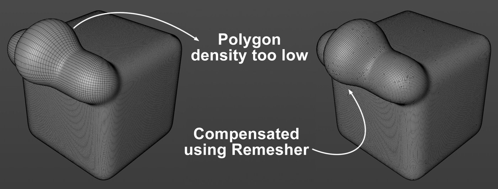
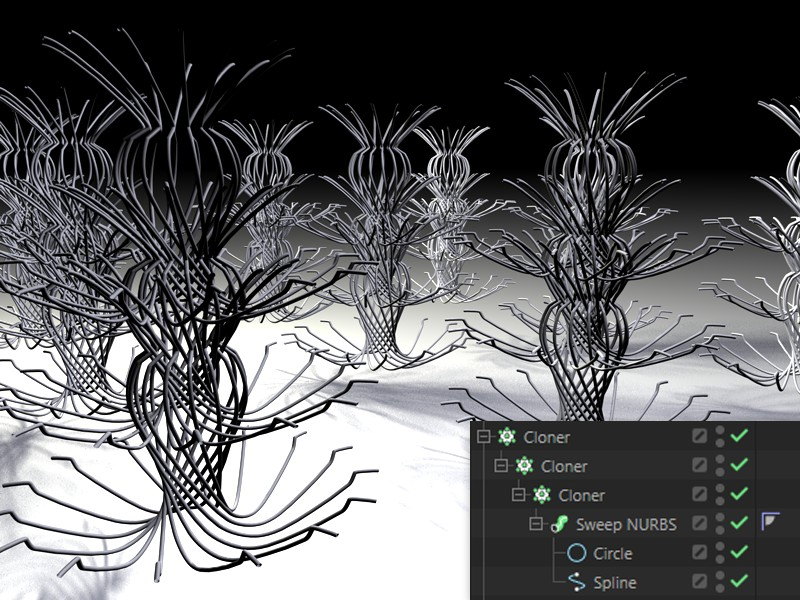
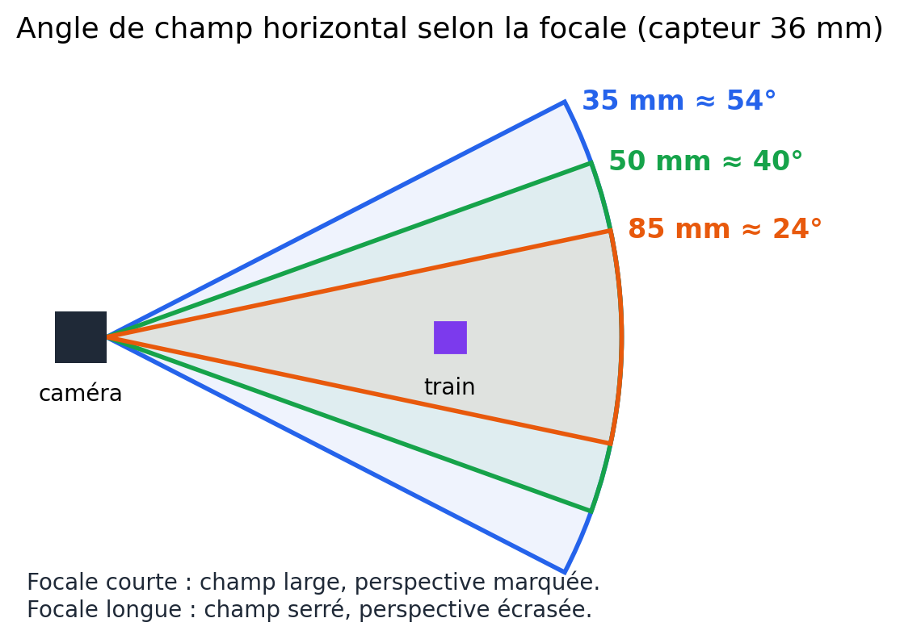

# Jour 5 – Retopologie, mise en scène, éclairage et rendu final

## Objectifs du jour

- Nettoyer n'importe quel maillage avec le Remesher.
- Finir et peupler la scène du petit train.
- Importer des assets externes sans piège d'échelle.
- Éclairer avec une HDRI et une seule lumière bien placée.
- Cadrer avec une caméra physique et développer l'image en post-traitement.

## Le Remesher : la retopologie automatique

Le [**Remesher**](https://help.maxon.net/c4d/en-us/Content/html/OREMESH.html) recalcule une surface pour produire un maillage majoritairement en quads, avec un flux d'arêtes qui suit la courbure. Il repose sur l'algorithme ZRemesher (issu de ZBrush). On y place l'objet en enfant.

{: .w90}
*Remesher : un scan au maillage chaotique (à gauche) est converti en quads réguliers, avec plus ou moins de polygones. — Source : aide officielle Cinema 4D (Maxon), page [Remesh](https://help.maxon.net/c4d/en-us/Content/html/OREMESH.html)*

**Pourquoi ?** Booléens, scans et imports CAO produisent des triangles longs, des N-Gons, des points isolés. Résultat : pincements au rendu, mauvaises déformations.

**Paramètres clés**

- **Densité de maillage (Mesh Density, %)** : pour explorer. 100 % garde le détail, 50 % simplifie.
- **Nombre de polygones (Polygon Count)** : pour la production. On fixe un budget (ex. 2000 polygones) et le Remesher s'y tient. Il uniformise le budget.
- **Adaptativité (Adaptiveness)** : 0 % = polygones tous identiques (bien pour les tissus) ; 100 % = petits dans les détails, grands sur les zones plates.
- **Détecter les arêtes vives (Detect Hard Edges / Keep Creases)** : lit le tag Phong ou les ruptures de lissage pour garder les angles nets. Indispensable en « hard surface ». Attention aux objets qui mélangent plusieurs tags Phong.
- **Symétrie** : calcule une moitié et la reflète. Topologie plus propre sur les objets symétriques.

**Cas d'usage**

- **Texte ou logo extrudé** : topologie propre en un clic, prête pour les déformateurs.
- **Volume (SDF)** : passer d'1 million à environ 1000 polygones en gardant la forme. Aller-retour possible : SDF → Remesher → SDS.
- **Booléen** : soit on garde une version légère + SDS, soit on garde la forme finale + un déformateur Biseau.
- **Extrusion, Loft, Balayage** : topologie régulière à la demande.
- **Tasse élaborée** : modélisée en SDF (Jour 4), puis simplifiée par le Remesher.

**Limite** : le Remesher n'est ni magique ni parfait. Une modélisation à la main restera toujours meilleure.

## Exercice : les rails courbés, version propre

1. Reprenez le rail droit percé par Booléen (Jour 3).
2. Placez-le dans un Remesher. Activez Détecter les arêtes vives.
3. Vous obtenez un rail en quads propres.
4. Appliquez le Spline Wrap. Le rail se courbe sans pincement ni artefact.

## Finition de la scène du petit train

**Outils de placement**

- **Outil Placer (Place Tool)** : détecte les normales des surfaces. Glissez une vis sur la locomotive : elle s'oriente perpendiculairement à la surface. Mise à l'échelle et rotation à la volée pendant le placement.
- **Placement dynamique (Dynamic Place)** : active une physique temporaire (gravité, collisions). Pour remplir le tender de charbon, sélectionnez 50 morceaux et laissez-les tomber : ils s'empilent naturellement.

**Disperser (Scatter) : forêts, herbe, gravier**

- **Outil Scatter** ou **Cloneur en mode Objet/Surface** : peint des instances sur une géométrie. Idéal pour une forêt autour de la voie.
- **Variation** : des clones identiques font faux. Ajoutez un [**Effecteur aléatoire (Random Effector)**](https://help.maxon.net/c4d/2025/en-us/Content/html/7443.html) sur Position, Échelle et Rotation. 10-20 % de variation de taille et une rotation aléatoire sur 360° (H) suffisent.

{: .w50}
*Le Cloneur multiplie des instances d'un même objet : la base pour disperser herbe, arbres ou cailloux. — Source : aide officielle Cinema 4D (Maxon), page [Cloner Object](https://help.maxon.net/c4d/en-us/Content/html/OMOGRAPH_CLONER.html)*

## Peupler la scène : Asset Browser et imports

- Utilisez l'Asset Browser pour l'arrière-plan : plantes, rochers, matériaux.
- **Formats d'import** :
    - **USD / USDZ / USDC** : à privilégier. Gère bien les hiérarchies lourdes et les matériaux PBR.
    - **GLB / GLTF** : léger, excellent pour les assets web.
    - **FBX** : standard historique, mais perd souvent les réglages de matériaux avancés.
- **Sources** : BlenderKit (pour ceux qui connaissent Blender : choisir des assets PBR et exporter en USD), outils de génération 3D comme Rodin.
- **Hero asset contre accessoires (props)** : le train est le **hero asset**, modélisé de A à Z, avec le meilleur éclairage. Un asset importé ne peut en aucun cas être le hero asset. Les accessoires guident le regard vers lui, sans le concurrencer.
- **Piège de l'échelle** : un arbre importé peut faire 2 mm ou 2 km. Vérifiez toujours par rapport au train et redimensionnez (outil Mettre à l'échelle le projet). Une échelle fausse casse la lumière et la profondeur de champ.
- **Rappel** : c'est le moment de réduire le train (modélisé à 100-200 cm) à son échelle de jouet.

## Éclairage : sculpter avec la lumière

**L'HDRI : l'ambiance globale**

- Elle apporte l'essentiel du réalisme : reflets complexes, lumière ambiante colorée.
- **Cohérence** : train jouet = HDRI « chambre » ou « studio ». Vrai train = extérieur, ciel.
- **Rotation** : tournez l'HDRI pour trouver l'angle qui sculpte le mieux les volumes (lumière de contour naturelle).

**La lumière de zone (Area Light) : la lumière principale**

- L'HDRI donne des ombres douces, sans direction nette.
- Ajoutez **une seule** Area Light bien choisie et bien placée. Elle fait toute la différence.
- **Position** : contre-jour ou 3/4 arrière pour révéler le métal et le bois.
- **Ne contredisez pas l'HDRI** : placez-la dans la direction de la source principale de l'HDRI.
- **Taille et ombres** : petite source = ombres nettes et dures (soleil, spot) ; grande source = ombres douces (ciel nuageux, softbox). Réglez aussi la densité de l'ombre.

## Caméra : l'œil du photographe

- **Créer et bloquer la caméra** : créez une caméra ([Camera Object](https://help.maxon.net/c4d/en-us/Content/html/OCAMERA.html)), cadrez, puis protégez-la (tag Protection) pour ne plus la bouger par erreur.
- **Focale** :
    - 50-85 mm : « portrait d'objet », perspective légèrement écrasée, le train gagne en prestance.
    - 35 mm : plus immersif et dynamique, mais déformations sur les bords.
- **Composition** : placez le train selon des lignes de force (règle des tiers), laissez de l'espace dans la direction de la locomotive.
- **Profondeur de champ (Bokeh / DoF)** : elle donne l'effet « maquette ». Activez le Bokeh dans la caméra Redshift, utilisez la pipette Distance de mise au point (Focus Distance) sur la cabine. Baissez le f-stop (f/2.8, f/1.8) pour flouter le fond. Trop de flou rend l'image illisible.

{: .w75}
*Angle de champ des focales courantes : plus la focale est longue, plus le champ est serré. — Schéma réalisé pour ce support*

## Le post-traitement (Post-FX) : développer l'image

Le rendu brut est souvent terne. On le « développe » comme une photo.

- **Tone mapping (ACES)** : compresse les hautes lumières pour garder détail et saturation au lieu d'aplats blancs. C'est le look « cinéma ».
- **Courbes** : ajustent contraste et luminosité.
- **Bloom** : halo lumineux autour des sources intenses (reflets sur le métal). Restez subtil.
- **Bokeh en post** : alternative plus rapide à la profondeur de champ de la caméra.
- **Étalonnage (LUT)** : une LUT (Look Up Table) applique un style en un clic (« Kodak », « Teal & Orange », noir et blanc contrasté).
- **À retenir** : ce sont des effets « triche », en 2D. Mais ils sont indispensables au réalisme.

## Raccourcis clavier du jour

| Action | Windows | Mac |
| :---- | :---- | :---- |
| Asset Browser | `Shift + F8` | `Shift + F8` |
| Rendu dans la vue | `Ctrl + R` | `Cmd + R` |
| Rendu dans la Visionneuse d'images | `Shift + R` | `Shift + R` |
| Réglages de rendu | `Ctrl + B` | `Cmd + B` |
| Recadrer sur la sélection / sur tout | `S` / `H` | `S` / `H` |
| Réglages du projet (OCIO) | `Ctrl + D` | `Cmd + D` |

## Points de vigilance

- Remesher sur un objet dur sans « Detect Hard Edges » = objet mou.
- Vérifiez l'échelle de chaque asset importé.
- Jamais d'asset importé comme hero asset.
- Une seule lumière principale, cohérente avec l'HDRI.
- Trop de flou ou de bloom = image illisible. Dosez.
