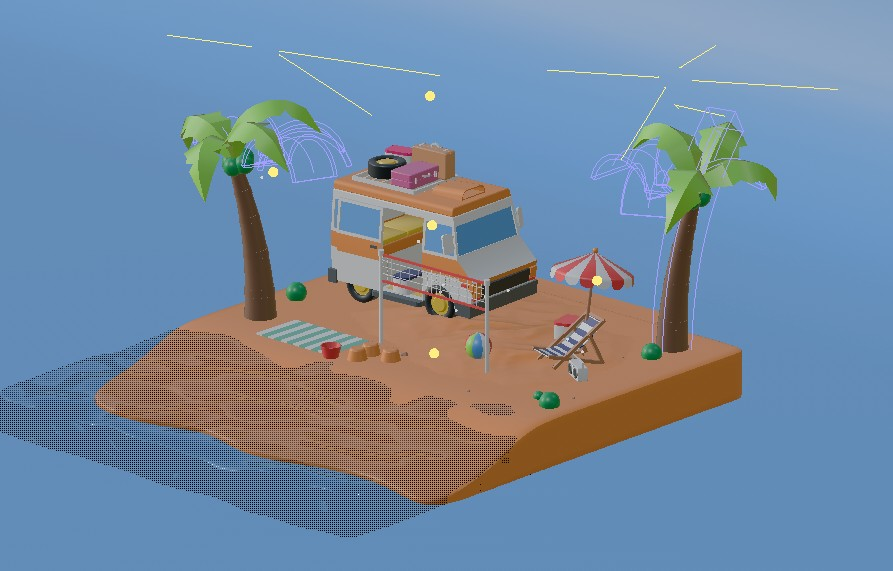
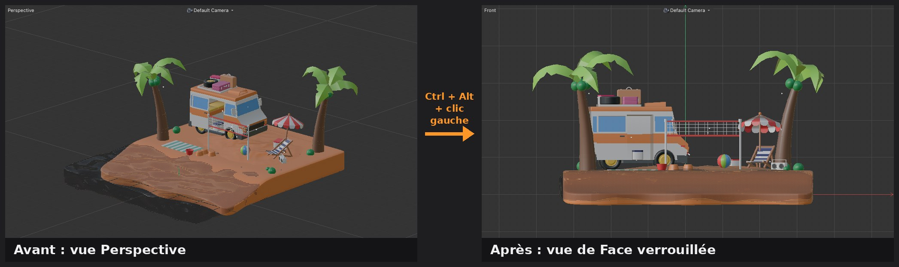
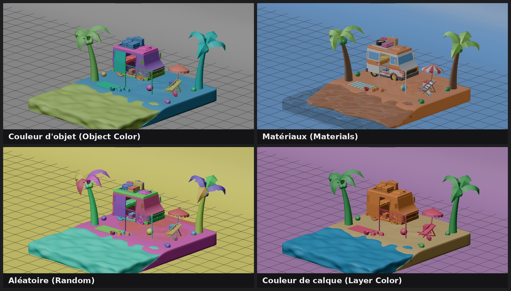
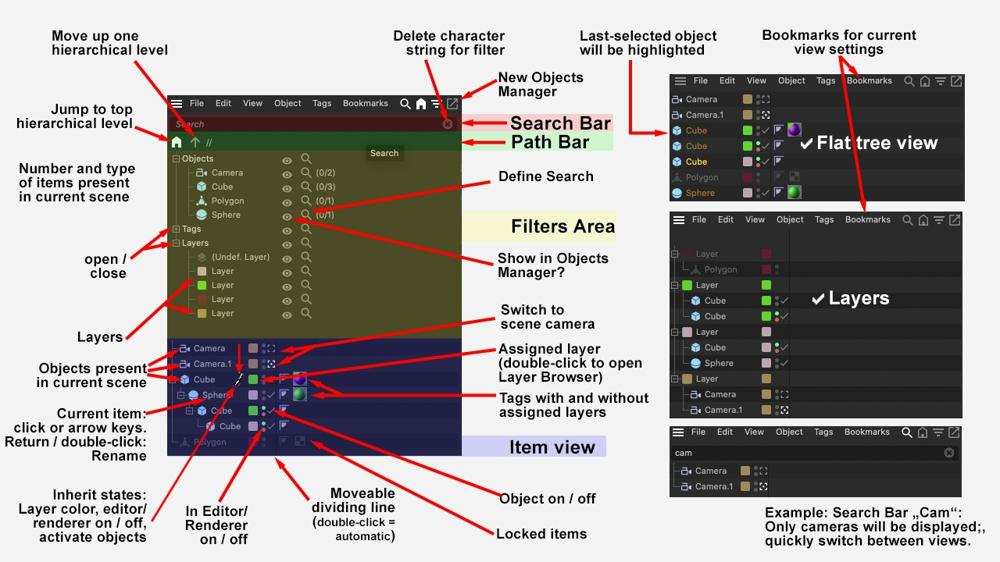
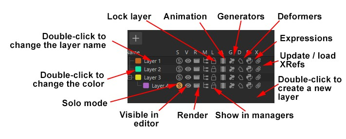
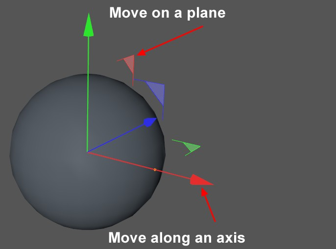
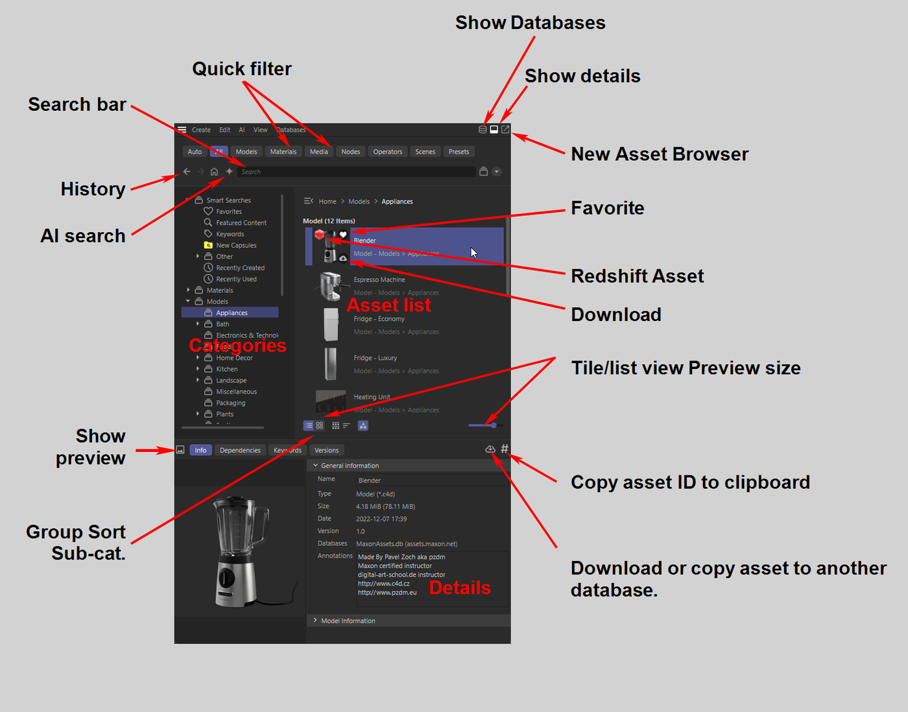
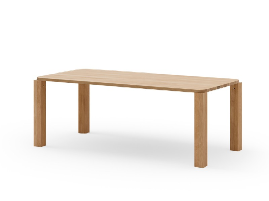
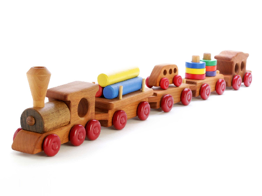

# Jour 1 – Interface, primitives et premiers pas

## Objectifs du jour

- Se repérer dans l'interface et naviguer avec aisance dans le viewport.
- Organiser une scène avec le Gestionnaire d'objets, les nuls, les tags et les calques.
- Créer et paramétrer des primitives, puis les déplacer, tourner et mettre à l'échelle avec précision.
- Obtenir un premier rendu éclairé en quelques clics.
- Préparer et démarrer le projet fil rouge : la locomotive.

## Scène de découverte

Pour explorer l'interface sur une vraie scène, téléchargez la scène d'exemple **Beach – Low Poly** : **[Beach-Low-Poly-Final.c4d](fichiers/Beach-Low-Poly-Final.c4d)**. Elle permet de tester la navigation et d'observer comment un professionnel organise sa hiérarchie (nuls, calques, rigs d'éclairage). D'autres scènes d'exemple sont disponibles dans l'**Explorateur d'assets (Asset Browser)**, rubrique Example Scenes.

{: .w75}
*La scène d'exemple Beach – Low Poly (scène de Gustavo Henrique) : idéale pour s'entraîner à naviguer. — Capture Cinema 4D*

## Navigation dans le viewport

Vous ne déplacez pas les objets quand vous naviguez : vous déplacez une caméra de travail invisible.

**Méthode 1 – Les icônes du viewport (en haut à droite)**

- Flèches croisées : déplacement latéral (Pan).
- Flèche de profondeur : zoom avant/arrière (Dolly).
- Flèche circulaire : orbite autour du centre de la vue ou de la sélection.
- Cette méthode est lente. Elle impose des allers-retours constants avec la souris. À abandonner dès que possible.

**Méthode 2 – Clavier et souris (méthode professionnelle)**

- `Alt + clic gauche` : orbiter. C'est le geste le plus utilisé.
- `Alt + clic droit` (ou molette) : zoomer. Le zoom se fait vers la position du curseur : pointez l'objet visé avant de zoomer.
- `Alt + clic molette` : déplacement latéral.
- Astuce ordinateur portable : maintenez `1` (Pan), `2` (Zoom) ou `3` (Orbite) et faites un clic gauche glissé. Pas besoin de souris trois boutons.

**Complément (doc Maxon)** : le comportement de l'orbite (autour du curseur, du centre, de l'objet sélectionné) se règle dans Préférences > Navigation caméra (Camera Navigation). Si l'orbite semble tourner « autour du vide », c'est souvent ce réglage ou un mauvais cadrage. Aide : [Camera Navigation](https://help.maxon.net/c4d/en-us/Content/html/PREFSNAVIGATION-PREF_NAVIGATION_MAIN_GROUP.html).

## Gestion des vues et cadrage

- **Les 4 vues (Quad View)** : un clic molette n'importe où dans le viewport bascule entre la vue Perspective seule et les quatre vues (Haut, Droite, Face, Perspective).
- **Touches F** : `F1` Perspective, `F2` Haut, `F3` Droite, `F4` Face, `F5` les quatre vues.
- **Vue orthographique** : les vues Haut, Droite et Face n'ont pas de perspective. Les lignes parallèles restent parallèles. Indispensable pour aligner deux objets (poser un vase sur une table sans qu'il flotte ni traverse le plateau).
- **Snap orthographique – `Ctrl + Alt + clic gauche` glissé** : depuis la vue Perspective, maintenez `Ctrl + Alt` et faites glisser avec le clic gauche, comme pour orbiter. La vue se verrouille sur la vue orthographique la plus proche (Face, Droite, Haut, etc.). Parfait pour modéliser rapidement ou placer un objet sans quitter la vue unique. Pour revenir aux 4 vues si besoin : clic molette ou `F5`.

{: .w100}
*Snap orthographique : `Ctrl + Alt + clic gauche` glissé fait passer la vue Perspective (à gauche) en vue de Face verrouillée (à droite). Scène : Beach – Low Poly. — Capture Cinema 4D 2027*

- **Recadrer sur la sélection (Frame Selected) – touche `S`** : la vue se centre sur l'objet sélectionné, qui devient le pivot de l'orbite. C'est le réflexe numéro un.
- **Recadrer sur tout (Frame All) – touche `H`** : la vue englobe toute la scène. Utile quand on s'est perdu.
- Ces deux touches fonctionnent aussi quand la souris survole le Gestionnaire d'objets.

## Les modes d'affichage (Shading)

Dans le menu Affichage (Display) du viewport, on choisit comment la carte graphique dessine les objets.

- **Ombrage Gouraud (Gouraud Shading) – `N~A`** : volumes lissés, éclairés par les lumières de la scène. Idéal pour présenter un modèle.
- **Ombrage Gouraud avec lignes (Gouraud Shading (Lines)) – `N~B`** : volume + maillage superposé. C'est le mode de travail par défaut (90 % du temps). Il montre la topologie : on voit si un cube a 1 ou 1000 segments, ce qui change tout pour les déformations.
- **Ombrage rapide (Quick Shading) – `N~C`** : comme Gouraud, mais avec un éclairage automatique au lieu des lumières de la scène. Plus rapide sur les scènes lourdes.
- **Ombrage constant (Constant Shading)** : couleur uniforme, sans volume. Utile pour vérifier une silhouette.
- **Lignes cachées (Hidden Line)** : n'affiche que les arêtes visibles, comme un dessin technique.
- **Lignes (Lines)** et style **Fil de fer (Wireframe) – `N~H`** : tout le maillage, y compris les arêtes cachées.
- **Boîte (Box)** et **Squelette (Skeleton)** : affichages ultra-légers pour les scènes très lourdes.

**Couleur d'affichage des objets (Color)**

Toujours dans le menu Affichage (Display) du viewport, le réglage **Couleur (Color)** choisit d'où vient la couleur des objets dans la vue :

- **Couleur d'objet (Object Color)** : la couleur d'affichage définie dans l'onglet Basique de chaque objet. Les objets sans couleur d'affichage restent gris. Pratique pour repérer les sous-ensembles d'une maquette.
- **Matériaux (Materials)** : la couleur des matériaux appliqués. C'est l'aperçu le plus proche du rendu.
- **Aléatoire (Random)** : une couleur différente par objet, attribuée automatiquement. Idéal pour voir d'un coup d'œil comment un modèle est découpé en objets.
- **Couleur de calque (Layer Color)** : la couleur du calque auquel appartient l'objet. Permet de vérifier que chaque objet est rangé dans le bon calque.

{: .w100}
*La même scène dans les quatre modes de couleur. Pour la vue Couleur d'objet, une couleur d'affichage a été donnée à chaque sous-ensemble (camping-car, accessoires, végétation, île). — Capture Cinema 4D 2027, scène Beach – Low Poly*

## Le Gestionnaire d'objets et les hiérarchies

Le [**Gestionnaire d'objets (Object Manager)**](https://help.maxon.net/c4d/en-us/Content/html/5743.html), à droite, est la colonne vertébrale du projet. Si c'est le chaos ici, ce sera le chaos au rendu et en animation.

{: .w100}
*Le Gestionnaire d'objets et ses zones : barre de recherche, filtres, calques, tags, objets verrouillés. — Source : aide officielle Cinema 4D (Maxon), page [Object Manager](https://help.maxon.net/c4d/en-us/Content/html/5743.html)*

**Les types d'objets (code couleur des icônes)**

- **Bleu** : primitives et objets de base (géométrie).
- **Vert** : générateurs (ils créent de la géométrie à partir de leurs enfants).
- **Violet** : déformateurs (ils déforment leur parent).
- **Splines** : courbes vectorielles, sans géométrie visible au rendu.

**Logique parent / enfant**

- Glissez l'objet B sur l'objet A : B devient l'enfant de A (il se décale vers la droite).
- **Position** : si le parent bouge, l'enfant suit. Ses coordonnées deviennent relatives au parent (coordonnées locales).
- **Rotation** : si le parent tourne, l'enfant orbite autour de lui.
- **Échelle** : l'enfant grandit ou rétrécit avec le parent. Une échelle non uniforme du parent déforme aussi l'enfant.
- `Ctrl + clic` sur le petit « + » déplie ou replie toute la hiérarchie d'un coup.

[**Le Gestionnaire d'attributs (Attribute Manager)**](https://help.maxon.net/c4d/en-us/Content/html/5822.html) (complément doc Maxon) : il affiche les paramètres de l'objet sélectionné. Il est organisé en onglets : Basique (Basic), Coordonnées (Coord.), Objet (Object), etc. C'est là qu'on règle tailles, segments, couleurs d'affichage.

**Les objets nuls (Null) et les groupes**

- Dans C4D, un groupe n'est pas un dossier : c'est un objet nul invisible, avec une position dans l'espace.
- **Grouper (`Alt + G`)** : C4D crée un nul parent et place son axe au barycentre (centre moyen) de la sélection.
- Usages du nul :
    - Organisation : ranger la scène (« Mur Sud », « Meubles »).
    - Animation : pivot déporté. Pour ouvrir une porte, on place la planche dans un nul positionné sur les charnières, et on tourne le nul.
- Astuce visuelle : dans l'onglet Basique du nul, passez l'Affichage (Display) de « Point » à « Cube » ou « Cercle », et changez sa couleur. Le contrôleur devient visible dans la vue, jamais au rendu.
- Vous pouvez aussi changer la **couleur d'affichage** de n'importe quel objet dans l'onglet Basique.

**Sélectionner dans le gestionnaire d’objets**

- Clic gauche sélectionne un seul objet.
    - Si on sélectionne un parent on ne sélectionne que celui-ci, pas les enfants !
- Clic du milieu sélectionne toute une hiérarchie
    - Si on sélectionne un parent on sélectionne ses enfants en même temps
- Plier/Déplier la hiérarchie : pour mieux organiser sa scène
    - En laissant appuyer Ctrl on déplie TOUTE la hiérarchie, aussi longue soit-elle
- La touche S permet de sélectionner dans le viewport, puis S dans le gestionnaire d’objets permet d’arriver directement à l’objet sélectionné.

**Les tags (étiquettes)**

- Petites icônes à droite des objets. Ils portent des propriétés non géométriques.
- **Tag Phong** : gère le lissage visuel des surfaces courbes (détaillé au Jour 3).
- **Tag Matériau (Material Tag)** : apparaît quand on applique un matériau.

**Les calques (Layers)**

- Ils gèrent des groupes d'objets indépendamment de la hiérarchie, comme en CAO. Aide : [Layer Manager and Layer Concept](https://help.maxon.net/c4d/en-us/Content/html/11074.html).
- Assignez une couleur de calque (ex. rouge pour les personnages, bleu pour le décor).
- Fonctions clés : **Verrouiller** (cadenas, empêche la sélection), **Masquer dans la vue** (œil), **Masquer au rendu** (caméra). Pratique pour cacher le plafond et travailler à l'intérieur d'une pièce.

{: .w75}
*Les commandes d'un calque : solo, visibilité dans la vue et au rendu, verrouillage, animation, générateurs, déformateurs. — Source : aide officielle Cinema 4D (Maxon), page [Layer Manager and Layer Concept](https://help.maxon.net/c4d/en-us/Content/html/11074.html)*

[**La Vue Solo (Viewport Solo)**](https://help.maxon.net/c4d/en-us/Content/html/52991.html)

- Isole l'objet sélectionné (et ses enfants) et cache temporairement tout le reste.
- Deux modes : **Automatique** (suit la sélection) et **Hiérarchie** (isole la sélection avec ses enfants).
- Pas de raccourci par défaut. Créez-le : Fenêtre > Personnalisation > Gestionnaire de commandes (Window > Customization > Command Manager), cherchez « Viewport Solo » et attribuez `Alt + Q`.

## Les primitives et leurs paramètres

Tout commence par une forme simple : c'est l'approche « block-out ».

- Cube, Sphère, Cylindre, Plan, Tore… sont des objets **paramétriques**. Ils sont définis par des paramètres (taille, rayon, segments), pas par des points fixes.
- Tant qu'ils ne sont pas convertis (**Rendre éditable (Make Editable) – touche `C`**), ils restent modifiables à tout moment, sans perte.
- **Poignées (Handles)** (complément doc Maxon) : les petits points orange sur une primitive sélectionnée permettent de modifier ses dimensions directement dans la vue.
- **Segments** : ils définissent la densité du maillage. Peu de segments = objet léger mais anguleux. Beaucoup de segments = objet lisse mais lourd, et prêt à être déformé.
- **Congé (Fillet)** : aucun objet réel n'a d'arête parfaitement vive. Cochez « Fillet » sur vos cubes et cylindres. Le petit arrondi accroche la lumière (reflet spéculaire) et donne du réalisme et de l'échelle.
- **Édition multiple (Multi-Edit)** : sélectionnez 50 cylindres et changez leur rayon en une seule fois dans le Gestionnaire d'attributs, tant qu'ils sont paramétriques.

## Déplacer, tourner, mettre à l'échelle (complément doc Maxon)

- [**Déplacer (Move)**](https://help.maxon.net/c4d/en-us/Content/html/TOOLMOVE.html) **– `E`**, **Échelle (Scale) – `T`**, **Rotation (Rotate) – `R`**.
- Cliquez-glissez sur une flèche d'axe pour contraindre le mouvement à cet axe (rouge = X, vert = Y, bleu = Z).
- **Quantification (Quantize) avec `Shift`** : maintenez `Shift` pendant la manipulation pour avancer par paliers réguliers (par défaut, 10° en rotation). Parfait pour des angles propres.
- **Coordonnées locales ou globales** : le système de l'axe peut suivre l'objet (Objet/local) ou le monde (Monde/global). La touche `W` bascule entre les deux. En local, « avancer en Z » suit l'orientation de l'objet ; en global, cela suit l'axe Z de la scène.
- [**Gestionnaire de coordonnées (Coordinate Manager)**](https://help.maxon.net/c4d/en-us/Content/html/5742.html) : pour saisir des valeurs exactes (ex. X = 0).
- **Dupliquer en déplaçant** : `Ctrl + glisser` une flèche d'axe dans la vue (ou `Ctrl + glisser` un nom dans le Gestionnaire d'objets).

{: .w50}
*L'outil Déplacer : glisser une flèche contraint le mouvement à un axe ; glisser un plan (petit triangle) déplace sur deux axes. — Source : aide officielle Cinema 4D (Maxon), page [Move](https://help.maxon.net/c4d/en-us/Content/html/TOOLMOVE.html)*

## Les objets générateurs : aperçu

Les générateurs (objets verts) ne contiennent pas de géométrie. Ils en produisent à partir de leurs enfants. Le générateur est le parent, la forme est l'enfant. Aujourd'hui, on retient juste leur existence :

- **Surface de subdivision (Subdivision Surface, SDS)** : lisse une forme anguleuse (détaillé au Jour 3).
- **Booléen (Boole)** : union, soustraction, intersection de volumes (appliqué au Jour 3).
- **Extrusion, Révolution, Balayage, Loft** : transforment des splines en volumes (Jours 2 et 3).

Les primitives sont vite limitées. Ces générateurs, puis la modélisation polygonale, permettront d'aller plus loin.

## Mise en scène rapide : éclairage, matériaux et rendu

- [**Asset Browser**](https://help.maxon.net/c4d/en-us/Content/html/79839.html) **(`Shift + F8`)** : bibliothèque de modèles, matériaux, HDRI et scènes. Complément doc Maxon : on peut chercher par mot-clé, marquer des **favoris** et télécharger les assets depuis le **cloud** Maxon à la demande. Tout se glisse-dépose dans la scène ou sur un objet.
- **Éclairage HDRI en un clic** : une HDRI (High Dynamic Range Image) est une image 360° qui contient de la vraie lumière. Créez un **Dôme de lumière (Dome Light)** (ou un Ciel (Sky)) et glissez-y une HDRI de l'Asset Browser. La scène est éclairée avec des reflets réalistes. Le choix fin de l'HDRI est vu au Jour 5\.
- **Matériaux en un clic** : glissez un matériau de l'Asset Browser sur un objet. Un tag Matériau apparaît.
- **Rendu dans la vue – `Ctrl + R`** : rendu rapide directement dans le viewport.
- **Rendu dans la Visionneuse d'images (Picture Viewer) – `Shift + R`** : rendu final, enregistrable.
- **Redshift Render View (IPR)** : rendu interactif qui se met à jour en temps réel quand vous modifiez la scène. C'est un studio photo virtuel.
- **Conseil d'interface** : ancrez la fenêtre de rendu à droite de la vue et affichez la barre de rendu. Enregistrez l'interface : Fenêtre > Personnalisation > Enregistrer la disposition au démarrage (Save Layout as Startup).

{: .w90}
*L'Asset Browser : recherche, filtres, favoris, téléchargement des assets depuis le cloud Maxon. — Source : aide officielle Cinema 4D (Maxon), page [The Asset Browser](https://help.maxon.net/c4d/en-us/Content/html/79839.html)*

## Exercice : la table simple

**Objectif** : comprendre le positionnement, la hiérarchie et la gestion des axes.

{: .w60}
*Référence pour l'exercice de la table simple : un plateau et quatre pieds. — Illustration du document d'origine*

1. Créez un Cube pour le plateau. Réglez sa hauteur (Y) à 5 cm.
2. Créez un Cube pour un pied. Placez-le sous un coin, en vérifiant dans les vues orthographiques.
3. Dupliquez le pied 3 fois (`Ctrl + glisser` l'axe).
4. **Le problème du groupe** : avec `Alt + G`, l'axe du nul se place au centre du plateau. Impossible alors de poser facilement la table au sol (Y = 0\) ou de la faire pivoter sur un pied.
5. **Solution A (manuelle)** : créez un nul vierge en 0,0,0, nommez-le « Table » et glissez-y les pieds et le plateau. L'axe est au sol.
6. **Solution B** : gardez le nul créé par `Alt + G` et déplacez uniquement son axe au sol (outil Activer l'axe (Enable Axis) – touche `L`).
7. **Empiler** : dupliquez la table et empilez les copies.
8. **Groupes de groupes** : regroupez plusieurs tables dans un nul parent. Vérifiez que chaque niveau garde un axe logique.
9. Appliquez une HDRI et un matériau, puis lancez un rendu `Ctrl + R`.

## Projet fil rouge : le petit train (locomotive)

{: .w60}
*Référence du projet fil rouge : un petit train jouet en bois. — Illustration du document d'origine*

## Préparation de la scène

1. **Références avec PureRef** : téléchargez PureRef (gratuit). Il garde une planche d'images toujours au premier plan. Règle absolue : ne modélisez jamais de mémoire. Le cerveau simplifie les formes.
2. **L'échelle** : la lumière, la profondeur de champ et la physique dépendent de la taille réelle. Un train de 5 cm est pénible à manipuler (caméra trop sensible, problèmes d'affichage). Modélisez « confortable », entre **100 et 200 cm** de long. Une fois fini, on groupera le tout et on réduira l'échelle.
3. **Gestion des couleurs (OCIO / ACES)** : dans les Réglages du projet (`Ctrl + D`), vérifiez le mode **OCIO** (ACEScg). Les hautes lumières sont mieux gérées, sans blancs brûlés. Dans les versions récentes, c'est le réglage par défaut : vérifiez simplement.
4. **Scène par défaut** : réglez OCIO et 25 ips, puis enregistrez comme scène par défaut. Attention : tout ce qui est dans la scène à ce moment-là apparaîtra dans chaque nouveau projet.

## Block-out de la locomotive

On assemble les grands volumes sans détails. Si les proportions sont fausses ici, le modèle final sera raté.

1. **La chaudière** : créez un Cylindre. Passez son Orientation à **+Z** ou **+X** pour le coucher. Dans l'onglet Couvercles (Caps), activez le Congé (Fillet).
2. **La cabine** : créez un Cube. Alignez-le sur la chaudière avec `F2`, `F3`, `F4`, sans qu'il flotte ni pénètre trop.
3. **Les roues** : créez un Cylindre court (un disque). Placez une roue, puis `Ctrl + glisser` l'axe X pour la dupliquer, parfaitement alignée.
4. **Hiérarchie** : groupez les deux roues d'un essieu (`Alt + G`), puis les trois essieux ensemble.
5. **Nommage** : nommez tout (« Roue\_AVG », « Roue\_AVD », « Cheminée »). C'est vital pour le texturing et l'animation.
6. **Couleurs d'affichage** : donnez une couleur par sous-ensemble (onglet Basique) pour mieux lire la maquette.
7. Tournez autour du modèle pour juger l'échelle et les rapports de forme.

## Raccourcis clavier du jour

| Action | Windows | Mac |
| :---- | :---- | :---- |
| Orbiter | `Alt + clic gauche` ou `3 + clic gauche` | `Option + clic gauche` ou `3 + clic gauche` |
| Zoomer | `Alt + clic droit` ou `2 + clic gauche` | `Option + clic droit` ou `2 + clic gauche` |
| Déplacement latéral | `Alt + clic molette` ou `1 + clic gauche` | `Option + clic molette` ou `1 + clic gauche` |
| Basculer 1 vue / 4 vues | `Clic molette` | `Clic molette` |
| Vues Persp. / Haut / Droite / Face / Toutes | `F1` à `F5` | `F1` à `F5` (avec `fn` si besoin) |
| Snap orthographique (verrouiller une vue ortho) | `Ctrl + Alt + clic gauche` glissé | `Cmd + Option + clic gauche` glissé |
| Recadrer sur la sélection | `S` | `S` |
| Recadrer sur tout | `H` | `H` |
| Gouraud / Gouraud + lignes / Rapide | `N~A` / `N~B` / `N~C` | `N~A` / `N~B` / `N~C` |
| Déplacer / Rotation / Échelle | `E` / `R` / `T` | `E` / `R` / `T` |
| Basculer coordonnées locales / globales | `W` | `W` |
| Quantifier (pas réguliers) | Maintenir `Shift` | Maintenir `Shift` |
| Activer l'axe | `L` | `L` |
| Grouper dans un nul | `Alt + G` | `Option + G` |
| Tout déplier / replier la hiérarchie | `Ctrl + clic` sur « + » | `Cmd + clic` sur « + » |
| Dupliquer en déplaçant | `Ctrl + glisser` | `Cmd + glisser` |
| Rendre éditable | `C` | `C` |
| Vue Solo (raccourci personnalisé) | `Alt + Q` | `Option + Q` |
| Asset Browser | `Shift + F8` | `Shift + F8` |
| Réglages du projet | `Ctrl + D` | `Cmd + D` |
| Rendu dans la vue | `Ctrl + R` | `Cmd + R` |
| Rendu dans la Visionneuse d'images | `Shift + R` | `Shift + R` |

## Points de vigilance

- Perdu dans la vue ? `S` ou `H` avant toute autre chose.
- Le groupe `Alt + G` place l'axe au centre de la sélection, pas au sol.
- Une échelle non uniforme sur un parent déforme ses enfants.
- Nommez vos objets dès leur création.
- Enregistrer une scène par défaut enregistre aussi son contenu : partez d'une scène vide.
