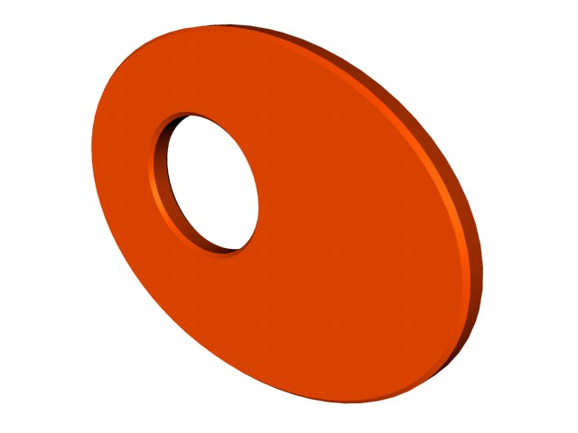
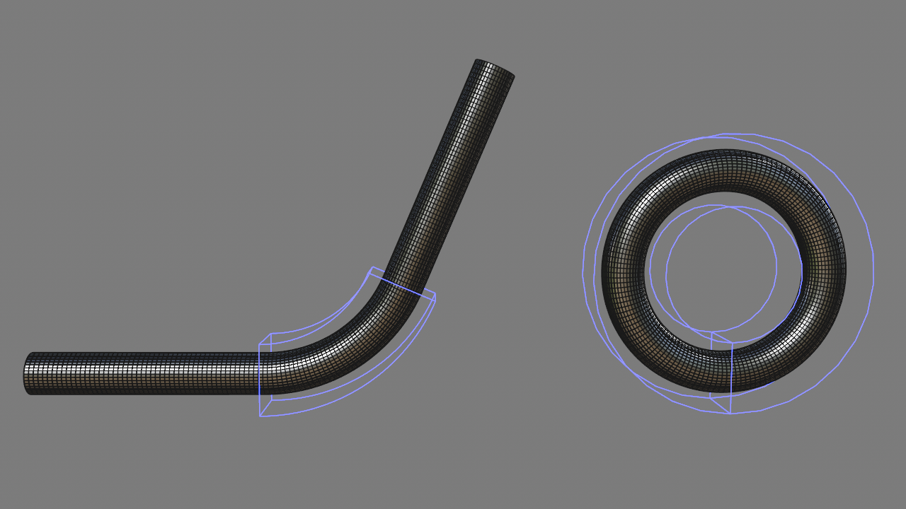
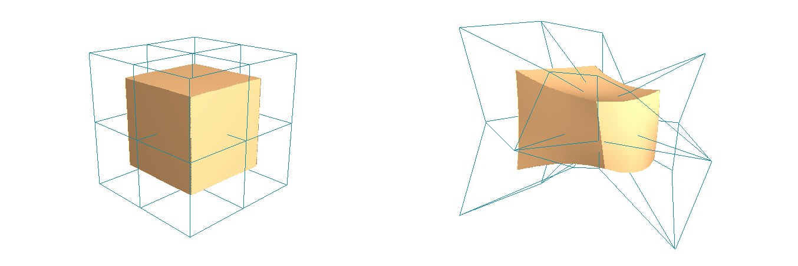
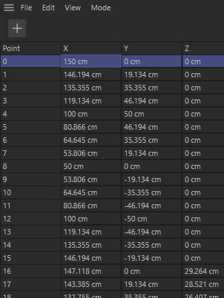

# Jour 2 – Splines, extrusion, déformateurs et premiers polygones

## Objectifs du jour

- Comprendre ce qu'est une spline et savoir la créer, l'éditer et la combiner.
- Passer de la 2D à la 3D avec l'objet Extrusion et maîtriser ses couvercles.
- Déformer de façon non destructive avec les déformateurs.
- Comprendre la structure d'un maillage : points, arêtes, polygones.
- Démarrer la base polygonale de la locomotive.

## Les splines : le squelette vectoriel

Une spline n'est pas de la géométrie. C'est une courbe mathématique, invisible au rendu. Elle sert de **composant** (profil d'un objet) ou de **trajectoire** (chemin d'un balayage, d'une animation). Les splines peuvent être 3D, mais on les garde en 2D la plupart du temps.

**Primitives de spline (paramétriques)**

- **Cercle, Rectangle, Texte, Profil, Hélice…**
- **Anneau (Ring)** : rayon interne et externe réglables directement.
- **Roue dentée (Cogwheel)** : types de dents réglables, idéal pour des engrenages.
- **Hélice (Helix)** : ressorts, vis, câbles de téléphone.
- **Plan de travail (Plane)** : par défaut XY. Choisissez XZ pour dessiner directement au sol, sans rotation.

[**Le Crayon spline (Spline Pen)**](https://help.maxon.net/c4d/en-us/Content/html/TOOLSPLINEPEN.html)

- Outil de dessin qui combine création et édition.
- Les **tangentes** sont symétriques par défaut. Maintenez `Shift` pour les casser (angle d'un côté, courbe de l'autre).
- La **longueur de la tangente** règle la tension de la courbe.
- Clic droit sur un point : **Interpolation dure (Hard Interpolation)** = angle vif ; **Interpolation douce (Soft Interpolation)** = courbe lisse.
- Attention à la confusion : le Crayon spline sélectionne et déplace aussi les points. Vérifiez l'outil actif.

**Éditer une spline**

- Rendez la spline éditable (`C`) pour modifier ses points un à un.
- **Chanfrein (Chamfer)** sur les points de spline : arrondit un angle.
- **Subdiviser (Subdivide)** : ajoute des points entre les points existants.

**Combiner des splines : le [Masque de spline (Spline Mask)](https://help.maxon.net/c4d/en-us/Content/html/OMOGRAPH_SPLINEMASK.html)**

- Équivalent du Pathfinder d'Illustrator : union, soustraction, intersection de splines fermées.
- Le résultat reste modifiable (ex. une clé mécanique faite de rectangles et de cercles).
- Les splines doivent être sur le même plan (généralement Z = 0).

{: .w33}
*Combiner rectangles et cercles avec le Masque de spline pour obtenir une forme complexe, restée paramétrique. — Illustration du document d'origine*

**Le Texte spline**

- Changez la police, puis manipulez chaque lettre séparément.
- C4D est très puissant pour la typographie 3D : c'est un point fort du logiciel en motion design.

**Importer un fichier Illustrator (.ai)**

- C4D importe les tracés. Les effets, dégradés et masques d'écrêtage sont ignorés. Aplatissez le design avant l'import.
- L'axe du logo importé est souvent loin du logo (à l'origine du document Illustrator). Recentrez-le : Outils > Axe > Centrer l'axe (Tools > Axis > Center Axis to).

## L'objet Extrusion (Extrude) et ses couvercles

L'Extrusion donne de l'épaisseur à une spline. Placez la spline en enfant de l'objet Extrusion. Aide : [Extrude Object](https://help.maxon.net/c4d/en-us/Content/html/OEXTRUDE.html).

{: .w50}
*Une spline Anneau (Ring) extrudée : le contour 2D devient un volume. — Source : aide officielle Cinema 4D (Maxon), page [Extrude Object](https://help.maxon.net/c4d/en-us/Content/html/OEXTRUDE.html)*

**Le rapport spline / polygone : 4 leviers de détail**

1. **Interpolation de la spline** = détail du contour (voir Jour 3).
2. **Subdivision de l'Extrusion** = détail de l'épaisseur.
3. **Type de couvercle (Caps)** = détail de la face avant et arrière.
4. La combinaison des trois donne la densité finale du maillage.

**Les couvercles et biseaux**

- **Biseau séparé (Separate Bevel)** : contrôle le biseau indépendamment de la géométrie.
- **Forme du biseau** : Rond (Round), Escalier (Step), Courbe (Curve). La forme Courbe dessine des moulures (cadres de tableaux) sans modéliser.

**Le piège du N-Gon**

- Par défaut, un couvercle est une seule face à plus de 4 côtés : un **N-Gon**. C'est propre pour une image fixe.
- Mais un N-Gon n'a pas de géométrie interne : il ne peut pas se courber. Un Twist ou un Bulge crée des pincements horribles.
- Solution : dans l'onglet Couvercles, choisissez **Quadrillage régulier (Regular Grid)** ou **Delaunay**. Des polygones apparaissent sur la face plate, qui peut alors se plier ou recevoir un déplacement (Displacement).
- Nuance : un maillage détaillé sur une surface plate est inutile si elle ne sera jamais déformée. Et un maillage de triangles réguliers vaut mieux que des N-Gons déformés dans tous les sens.

## Les déformateurs : sculpture non destructive

Les déformateurs (objets violets) agissent sur les points de l'objet, sans modifier sa nature. On les place en enfant de l'objet à déformer. Aide : [Deformer](https://help.maxon.net/c4d/en-us/Content/html/5460.html), [Bend Object](https://help.maxon.net/c4d/en-us/Content/html/OBEND.html).

**Les 5 déformateurs principaux**

- **Courbure (Bend)** : le plus polyvalent. Tuyau qui se plie, page qui se tourne.
- **Renflement (Bulge)** : gonfle ou pince le centre.
- **Torsion (Twist)** : vrille l'objet sur son axe.
- **Effilement (Taper)** : rétrécit une extrémité.
- **Cisaillement (Shear)** : incline l'objet.

{: .w75}
*Déformateur Courbure (Bend) : le même tube droit, plié à 90°, puis enroulé en anneau. La cage violette montre la zone d'action. — Source : aide officielle Cinema 4D (Maxon), page [Bend Object](https://help.maxon.net/c4d/en-us/Content/html/OBEND.html)*

**La cage de déformation**

- Chaque déformateur a une boîte violette : c'est sa zone d'action. Les déformateurs sont **spatiaux**.
- **Adapter au parent (Fit to Parent)** : premier bouton à cliquer. Il ajuste la cage à la taille de l'objet.
- **Modes** : Limité (Limited), Dans la boîte (Within Box), Illimité (Unlimited). Ils décident de ce qui se passe en dehors de la cage.
- **Animer la cage** : déplacer la cage suffit à créer une animation. Exemple : une vis infinie en déplaçant un Twist le long d'un cylindre.

**L'ordre compte !**

- C4D lit les déformateurs de haut en bas. Un Bend puis un Twist ne donne pas le même résultat qu'un Twist puis un Bend.
- Les combinaisons sont infinies. Testez l'ordre.

**Autres déformateurs utiles**

- [**FFD (Free Form Deformation)**](https://help.maxon.net/c4d/en-us/Content/html/OFFD.html) : une grille de points de contrôle autour de l'objet. On déforme doucement, comme une cage de Bézier. Idéal pour ajuster des proportions ou faire du « squash & stretch ».
- **Déplaceur (Displacer)** : déforme la géométrie selon une texture (souvent un Bruit (Noise)). Terrains, eau, surfaces froissées. Demande beaucoup de polygones.
- [**Enveloppe de spline (Spline Wrap)**](https://help.maxon.net/c4d/en-us/Content/html/OMOGRAPH_SPLINEWRAP.html) : un déformateur « composé » qui enroule un objet le long d'une spline.
    - **Conserver la longueur (Keep Length)** : coché, l'objet garde sa taille ; décoché, il s'étire sur toute la spline.
    - Si l'objet vrille dans les virages, ajoutez une spline **Rail** pour stabiliser son orientation.

{: .w75}
*FFD : on déplace les points de la grille (à droite) et l'objet se déforme en douceur. — Source : aide officielle Cinema 4D (Maxon), page [FFD Object](https://help.maxon.net/c4d/en-us/Content/html/OFFD.html)*

## Exercice : la corde animée

1. Créez un segment de corde (ex. un cylindre fin ou une capsule).
2. Clonez-le le long d'une trajectoire avec un [**Cloneur (Cloner)**](https://help.maxon.net/c4d/en-us/Content/html/OMOGRAPH_CLONER.html).
3. Ajoutez une **Torsion (Twist)** pour simuler le tressage.
4. Dessinez une trajectoire au Crayon spline ou à l'outil **Esquisse (Sketch)**.
5. Ajoutez un **Spline Wrap** pour que la corde suive ce tracé. Animez sa position pour faire « courir » la corde.

## Introduction à la modélisation polygonale

Après les objets paramétriques, on descend au niveau le plus bas de la 3D : le polygone. Tout objet converti (`C`) en est fait.

**Le point : seule réalité géométrique**

- Un objet 3D n'est qu'une liste de **points** (coordonnées X, Y, Z).
- Une **arête (Edge)** relie 2 points.
- Un **polygone** est délimité par 3 arêtes ou plus (triangle = 3, quad = 4).
- Le [**Gestionnaire de structure (Structure Manager)**](https://help.maxon.net/c4d/en-us/Content/html/5872.html) affiche les points sous forme de tableau, comme une feuille de calcul. Ce n'est pas un hasard : les premiers logiciels 3D des années 60-70 fonctionnaient littéralement avec des coordonnées saisies en tableau. La 3D, ce sont des chiffres organisés dans l'espace.

{: .w40}
*Le Gestionnaire de structure : chaque point est une ligne de coordonnées X, Y, Z, comme dans un tableur. — Source : aide officielle Cinema 4D (Maxon), page [Structure Manager](https://help.maxon.net/c4d/en-us/Content/html/5872.html)*

**Les modes de sélection**

- `1` : mode Points.
- `2` : mode Arêtes.
- `3` : mode Polygones.
- `4` : mode Modèle (Model) : on manipule l'objet entier.
- Ces raccourcis sont à créer dans le Gestionnaire de commandes (comme pour la Vue Solo). Les touches `1`, `2`, `3` servent aussi à la navigation : si vous les réassignez, naviguez avec `Alt + souris`.
- Piège classique : rester en mode Points en voulant déplacer l'objet. On déforme la géométrie au lieu de la déplacer. Vérifiez toujours le mode actif.

## Exercice : base polygonale de la locomotive

On reprend le block-out du Jour 1 pour ajouter du détail réel.

1. Rendez la cabine éditable (`C`).
2. **Extrusion polygonale (Extrude) – `D`** : en mode Polygones, sélectionnez une face et poussez-la le long de sa normale. Exemples : creuser les fenêtres de la cabine, amorcer la cheminée directement depuis la chaudière.
3. **Chanfrein polygonal (Chamfer)** : contrairement au Fillet (réservé aux primitives), il fonctionne sur tout objet éditable.
    - Sur une arête : remplace l'arête vive par un biseau plat ou arrondi (option Arrondi (Rounding)).
    - Sur un point : coupe le coin en biais.
    - Sur un polygone : insère une boucle tout autour de la face.
4. Chanfreinez les arêtes principales pour qu'elles accrochent la lumière.

**Topologie (introduction)** : l'organisation des points, arêtes et polygones s'appelle la **topologie**. Elle décide si l'objet se lissera et se déformera bien. Règle du jour : privilégiez les faces à 4 côtés (quads). Le sujet est approfondi aux Jours 3 et 4\.

## Raccourcis clavier du jour

| Action | Windows | Mac |
| :---- | :---- | :---- |
| Casser la tangente (Crayon spline) | Maintenir `Shift` | Maintenir `Shift` |
| Rendre éditable | `C` | `C` |
| Mode Points / Arêtes / Polygones / Modèle (personnalisé) | `1` / `2` / `3` / `4` | `1` / `2` / `3` / `4` |
| Extrusion polygonale | `D` ou `M~T` | `D` ou `M~T` |
| Adapter le déformateur au parent | Bouton « Fit to Parent » | Bouton « Fit to Parent » |

## Points de vigilance

- Couvercle en N-Gon + déformateur = pincements. Passez en Regular Grid ou Delaunay.
- Ne pas confondre Spline et Polygones !!! Ce sont des objets radicalement différent dont les outils ne sont pas compatibles entre eux malgré des noms parfois similaires !
- Déformateur sans effet ? Vérifiez qu'il est bien enfant de l'objet et que la cage l'englobe.
- L'ordre des déformateurs change le résultat.
- Fichier .ai : aplatir avant import, puis recentrer l'axe.
- Mode Points actif = on déforme au lieu de déplacer.
