# Jour 3 – Générateurs avancés, shading et subdivision de surface

## Objectifs du jour

- Maîtriser la résolution des splines pour préparer les déformations.
- Utiliser les trois générateurs de volume : Balayage, Révolution, Loft.
- Comprendre le shading (normales, tag Phong) et distinguer un problème de shading d'un problème de géométrie.
- Modéliser les rails du petit train.
- Découvrir la Surface de subdivision et modéliser une tasse de café monobloc.

## L'interpolation des splines : le maillage invisible

Une spline est une courbe parfaite. Pour l'afficher et la transformer en volume, C4D la découpe en petits segments droits. Le réglage **Interpolation** décide comment.

- **Adaptatif (Adaptive, défaut)** : des points dans les virages, un seul segment sur les lignes droites. Très léger. Piège : un tuyau droit qu'on plie plus tard cassera net, faute de points intermédiaires.
- **Uniforme (Uniform)** : segments de longueur égale partout. **Obligatoire** pour toute spline destinée à être déformée (Bend, Spline Wrap, dynamique).
- **Naturel (Natural)** : variante de l'uniforme qui suit mieux la courbure.
- **Subdivisé (Subdivided)** : comme l'adaptatif, avec une subdivision minimale même sur les lignes droites.

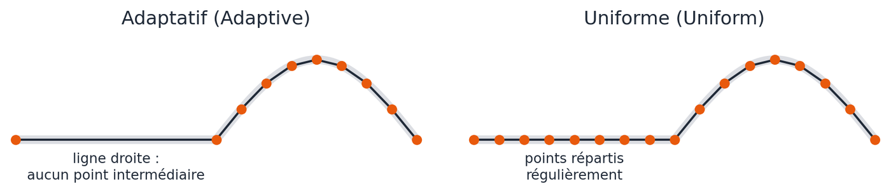{: .w90}
*Interpolation Adaptative contre Uniforme : sur la ligne droite, l'adaptatif ne place aucun point ; une déformation y cassera net. — Schéma réalisé pour ce support*

Ces points de spline deviennent les segments du contour de l'objet généré. Combinés à la subdivision d'épaisseur du générateur et au type de couvercle (vu au Jour 2), ils donnent un maillage prêt à être déformé.

**Exercice rapide** : créez un Texte spline dans une Extrusion. Réglez interpolation Uniforme, subdivisions et couvercles Regular Grid. Ajoutez un Twist puis un Bend : aucun artefact.

## Le Balayage (Sweep) : câbles, néons, calligraphie

Il fait glisser un profil le long d'une trajectoire. Aide : [Sweep object](https://help.maxon.net/c4d/en-us/Content/html/OSWEEP.html).

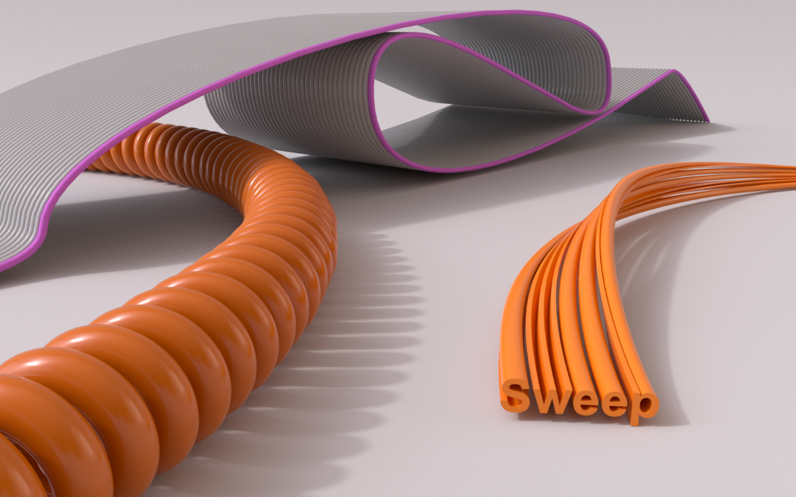{: .w75}
*Exemples de balayages : câble torsadé, ruban, texte. Un profil qui suit une trajectoire. — Source : aide officielle Cinema 4D (Maxon), page [Sweep object](https://help.maxon.net/c4d/en-us/Content/html/OSWEEP.html)*

- **Hiérarchie** : 1er enfant = le profil (ex. un Cercle), 2e enfant = la trajectoire.
- **Détails (graphes)** : les courbes Échelle (Scale) et Rotation sculptent le profil le long du chemin (queue qui s'affine, racine qui ondule, écriture calligraphique qui gère l'épaisseur).
- **Rail** : une troisième spline qui contrôle l'orientation ou l'épaisseur du balayage.
- **Croissance (End Growth)** : anime l'apparition du tracé. Parfait pour un texte néon style années 80 qui s'écrit tout seul.

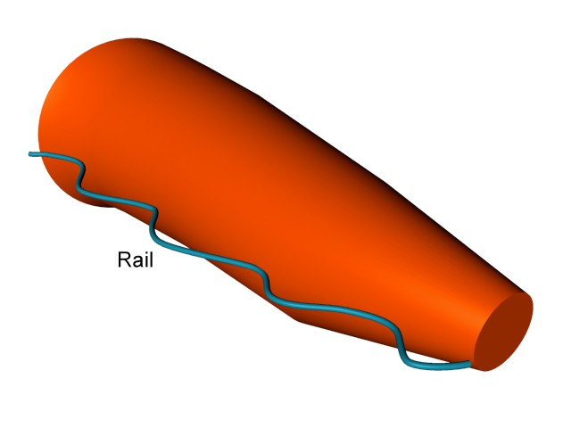{: .w50}
*Une spline Rail (en bleu) contrôle la forme du balayage le long du chemin. — Source : aide officielle Cinema 4D (Maxon), page [Sweep object](https://help.maxon.net/c4d/en-us/Content/html/OSWEEP.html)*

## La Révolution (Lathe) : la poterie numérique

Elle fait tourner un profil autour de l'axe Y. Idéal pour verres, bouteilles, vases, pions d'échecs. Aide : [Lathe object](https://help.maxon.net/c4d/en-us/Content/html/OLATHE.html).

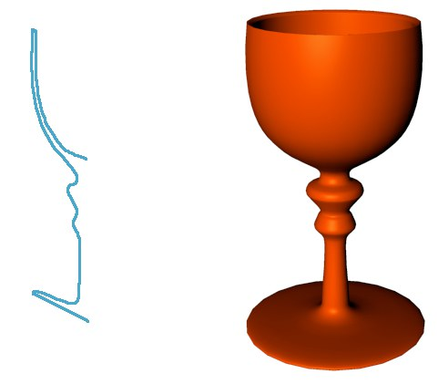{: .w50}
*Révolution : le demi-profil dessiné en vue de Face (à gauche) devient un verre à pied (à droite). — Source : aide officielle Cinema 4D (Maxon), page [Lathe object](https://help.maxon.net/c4d/en-us/Content/html/OLATHE.html)*

- Dessinez la moitié du profil en vue de Face (`F4`).
- **Profil sur l'axe** : les points du centre doivent être exactement à X = 0, sinon trou central ou faces croisées (artefact noir). Sélectionnez ces points et tapez X = 0 dans le Gestionnaire de coordonnées.
- **Épaisseur** : la commande **Créer un contour (Create Outline)** donne une épaisseur aux parois (vase creux).
- **Déplacer l'axe sans bouger les enfants** : maintenez la touche `7` du pavé numérique en déplaçant le parent, ou utilisez Activer l'axe (`L`). En décentrant l'axe, on obtient une rampe d'escalier ou une hélice.

**Exercice : le verre à pied**

{: .w33}
*Référence pour l'exercice du verre à pied (Révolution). — Illustration du document d'origine*

1. En vue de Face, tracez le profil au Crayon spline.
2. Arrondissez les angles avec le Chanfrein de spline.
3. Ajoutez l'épaisseur avec Créer un contour.
4. Placez les points centraux à X = 0\.
5. Mettez la spline dans une Révolution.

## Le Loft : carrosserie et formes organiques

Il tend une peau entre plusieurs profils successifs. Aide : [Loft object](https://help.maxon.net/c4d/en-us/Content/html/OLOFT.html).

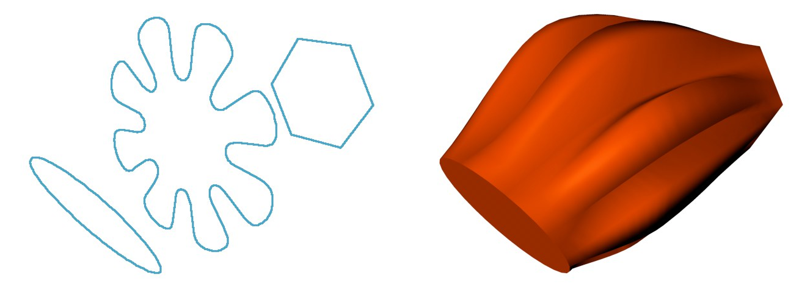{: .w90}
*Loft : trois splines de formes différentes (à gauche) et la peau tendue entre elles (à droite). — Source : aide officielle Cinema 4D (Maxon), page [Loft object](https://help.maxon.net/c4d/en-us/Content/html/OLOFT.html)*

- L'ordre des splines enfants définit l'ordre des « côtes ».
- **Boucle (Loop)** : ferme la forme sur elle-même.
- **Épaisseur** : doublez les splines (une série intérieure, une extérieure).
- **Subdivisions** : le Loft génère beaucoup de polygones. Réduisez les subdivisions U/V si le maillage est trop dense.

**Exercice : le donut** : clonez un Cercle en cercle avec un Cloneur, placez le tout dans un Loft et cochez Boucle.

## Le shading : normales et tag Phong

Le shading est l'illusion qui fait paraître courbe une surface faite de faces plates.

**Les normales**

- Chaque polygone a une direction : un devant et un derrière (sa **normale**).
- L'éclairage calcule l'intensité de chaque face selon l'angle entre sa normale et la lumière.
- Une face retournée peut paraître noire ou transparente. Faces orientées vers l'extérieur = couleur par défaut ; si une face apparaît d'une autre couleur, utilisez **Inverser les normales (Reverse Normals)**.

**Le problème des facettes**

- Mauvaise solution : ajouter des faces (le fichier s'alourdit).
- Bonne solution : tricher le shading avec le tag Phong.

[**Le tag Phong (lissage)**](https://help.maxon.net/c4d/en-us/Content/html/TPHONG.html)

- Il crée un dégradé de lumière entre faces voisines pour simuler une courbe.
- **Limite d'angle (Angle Limit)** : si l'angle entre deux faces est sous le seuil (ex. 40°), la jonction est lissée ; au-dessus, l'arête reste vive. Sans limite, un cube à 6 faces devient une tache informe.
- **Rompre le lissage (Break Phong Shading)** : sélectionnez des arêtes > clic droit > Rompre l'ombrage Phong. Pour une rainure nette sur une surface lisse (ex. une Pokéball).
- **Les algorithmes de shading** : l'algorithme de base peut produire des dégradés sales sur un cube chanfreiné. Testez les autres options du tag Phong.

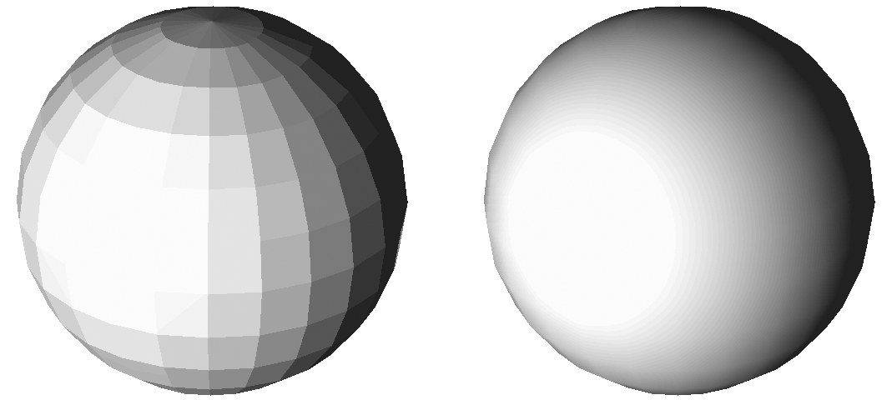{: .w75}
*La même sphère, sans tag Phong (facettes visibles) puis avec (surface lisse). La géométrie est identique. — Source : aide officielle Cinema 4D (Maxon), page [Phong Tag](https://help.maxon.net/c4d/en-us/Content/html/TPHONG.html)*

**Diagnostic** : des ombres noires bizarres ? C'est souvent un problème de normales ou de Phong, pas de géométrie. Apprenez à distinguer les deux avant de tout remodéliser.

## Projet fil rouge : les rails du petit train

Objectif : des rails en bois type « Brio », courbés.

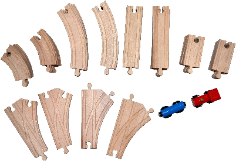{: .w60}
*Référence des rails en bois type « Brio » : sections droites et courbes, encoches d'assemblage. — Illustration du document d'origine*

1. **Le profil** : un Rectangle + deux Cercles, fusionnés par un **Masque de spline** en mode Union. Le profil reste modifiable.
2. **Le volume** : placez le masque dans une Extrusion. Augmentez les segments de profondeur et passez les couvercles en Regular Grid pour préparer la courbure.
3. **Les encoches** : un **Cloneur** de deux boîtes (cubes) espacées régulièrement, soustrait au rail avec un **Booléen (Boole)** en mode A moins B. Dans les versions récentes, l'ancien objet Boole (legacy) est remplacé par le [Boolean Generator](https://help.maxon.net/c4d/en-us/Content/html/OBOOLEANGENERATOR.html) ; le principe reste le même.
    - Le maillage devient « sale » (N-Gons, triangles). Pour un objet statique rigide, c'est acceptable. Pour une animation déformante, à éviter.
4. **La courbure** : un **Spline Wrap** avec la spline du tracé. Plus souple que de modéliser un rail déjà courbé.
5. **Limite** : le maillage booléen se déforme mal. Il n'existe pas de solution parfaite à ce stade. Le Jour 5 apportera la solution propre (Remesher).

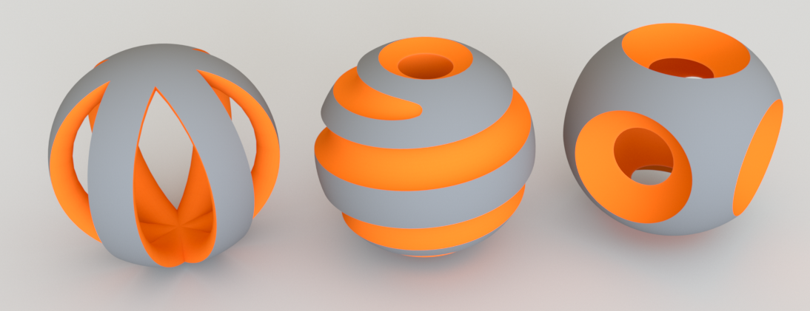{: .w75}
*Opérations booléennes : une forme en soustrait une autre pour creuser, percer ou découper. — Source : aide officielle Cinema 4D (Maxon), page [Boolean Generator](https://help.maxon.net/c4d/en-us/Content/html/OBOOLEANGENERATOR.html)*

## La Surface de subdivision (Subdivision Surface, SDS)

Le SDS est la norme pour la modélisation organique. Aide : [Subdivision Surface](https://help.maxon.net/c4d/en-us/Content/html/OSDS.html). On modélise une cage peu détaillée, le SDS la lisse.

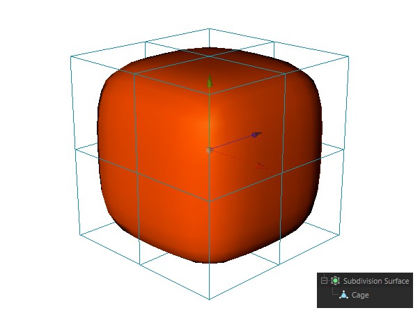{: .w50}
*Un cube (la cage, en fil de fer) lissé par le SDS : on modélise la cage, le SDS calcule la surface lisse. — Source : aide officielle Cinema 4D (Maxon), page [Subdivision Surface](https://help.maxon.net/c4d/en-us/Content/html/OSDS.html)*

**Principe** : l'algorithme (Catmull-Clark) divise chaque face en 4 et arrondit le résultat.

**Le dogme des quads**

- **Quad** : division parfaite, lissage prévisible.
- **Triangle** : crée un pôle (étoile) qui pince la lumière. À éviter sur les zones courbes.
- **N-Gon** : comportement imprévisible. À bannir sous SDS.
- Conclusion : des quads, des quads, des quads.
- **Oui, mais** : sur une surface plane, quelques triangles passent. Et des quads de tailles très inégales, ça ne va pas non plus.

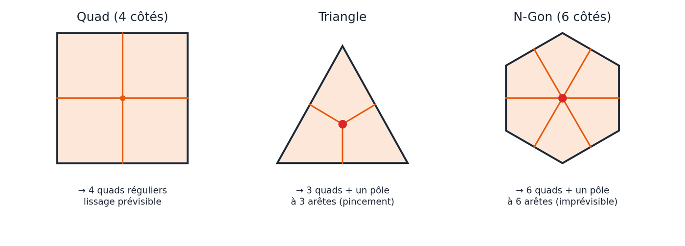{: .w90}
*Ce que fait le SDS à chaque type de face : le quad se divise proprement ; triangle et N-Gon créent un pôle (point rouge) qui pince le lissage. — Schéma réalisé pour ce support*

**Durcir les bords : boucles de soutien (Holding Edges)**

- Sous SDS, tout devient mou. Ajoutez des boucles d'arêtes près des bords avec la [**Coupe en boucle (Loop Cut)**](https://help.maxon.net/c4d/en-us/Content/html/TOOLKNIFEPATH.html) **– `K~L`**. Plus la boucle est proche du bord, plus l'angle est net.
- Alternative : le modificateur **Biseau (Bevel)** en déformateur, pour gérer les arêtes de bord de façon non destructive.

## Exercice : la tasse de café monobloc (SDS)

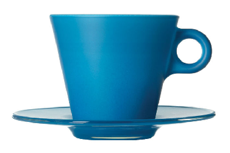{: .w50}
*Référence de la tasse : corps et anse forment un seul objet. — Illustration du document d'origine*

**Pourquoi pas avec les outils vus jusqu'ici ?** Extrusion, Révolution, Balayage, Loft, Booléen ou primitives ne savent pas produire un corps et une anse fusionnés avec un maillage continu et lissable.

1. **La base** : plusieurs méthodes existent, aucune n'est la meilleure. Ici : un Tube (ou un Cylindre sans couvercles) + un **Effilement (Taper)** pour l'évaser. Choisissez très soigneusement le nombre de segments en hauteur et en rotation.
2. **L'anse** : un Tore, placé contre le corps. Son nombre de segments doit correspondre aux faces du corps là où il se connecte.
3. **Figer les déformations** : **Objet d'état courant (Current State to Object)** crée une copie polygonale avec les déformateurs appliqués. Différence : Rendre éditable (`C`) convertit l'objet seul ; Connecter les objets et supprimer (Connect Objects + Delete) fusionne plusieurs objets en un seul et supprime les originaux.
4. **Fusionner** : sélectionnez corps et anse, puis Connecter les objets et supprimer.
5. **Relier** : supprimez les faces du corps et de l'anse face à face, puis reliez les trous avec [**Pont (Bridge)**](https://help.maxon.net/c4d/en-us/Content/html/TOOLBRIDGE.html) **– `B`**.
6. **Vérifier (non-manifold)** : regardez à l'intérieur. Aucune face interne ne doit bloquer le passage. Utilisez le fil de fer, la [**Vérification du maillage (Mesh Checking)**](https://help.maxon.net/c4d/en-us/Content/html/DMODELING-MESH_CHECK.html) (Gestionnaire d'attributs > Mode > Modélisation), et masquez/affichez des polygones pour voir dedans.
7. **L'épaisseur** : le générateur [**Épaissir (Thicken)**](https://help.maxon.net/c4d/en-us/Content/html/TOOLSOLIDIFY.html) (ou la commande du même nom) transforme une surface à une seule couche en volume fermé. On le réutilisera au Jour 4\.
8. **Le lissage** : placez l'objet dans un SDS, puis ajoutez des boucles de soutien au bord supérieur et à la jonction de l'anse.

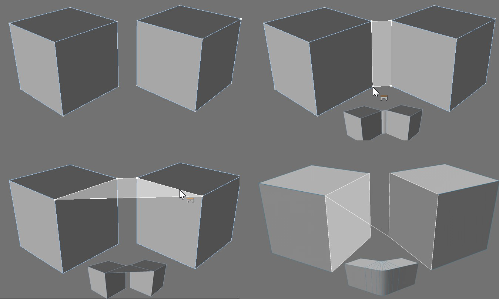{: .w75}
*L'outil Pont (Bridge) relie deux ouvertures par de nouveaux polygones : c'est ainsi qu'on raccorde l'anse au corps. — Source : aide officielle Cinema 4D (Maxon), page [Bridge](https://help.maxon.net/c4d/en-us/Content/html/TOOLBRIDGE.html)*

## Raccourcis clavier du jour

| Action | Windows | Mac |
| :---- | :---- | :---- |
| Déplacer le parent sans ses enfants | Maintenir `7` (pavé num.) | Maintenir `7` (pavé num.) |
| Activer l'axe | `L` | `L` |
| Vue de Face | `F4` | `F4` (avec `fn` si besoin) |
| Coupe en boucle | `K~L` ou `M~L` | `K~L` ou `M~L` |
| Pont | `B` ou `M~B` | `B` ou `M~B` |
| Rendre éditable | `C` | `C` |

## Points de vigilance

- Spline à déformer = interpolation Uniforme.
- Révolution : points centraux à X = 0 exactement.
- Ombres noires = vérifiez normales et Phong avant la géométrie.
- Booléen = maillage sale, acceptable seulement pour des objets statiques.
- Sous SDS : quads réguliers, et on corrige la cage, jamais le résultat lissé.
- Faces internes après un Pont = non-manifold. Vérifiez toujours l'intérieur.
