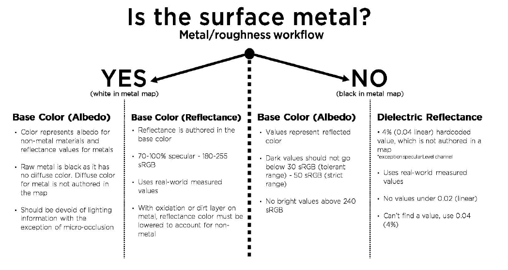
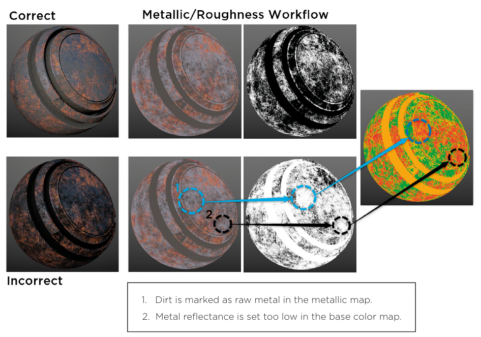
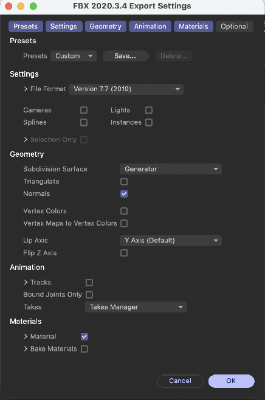
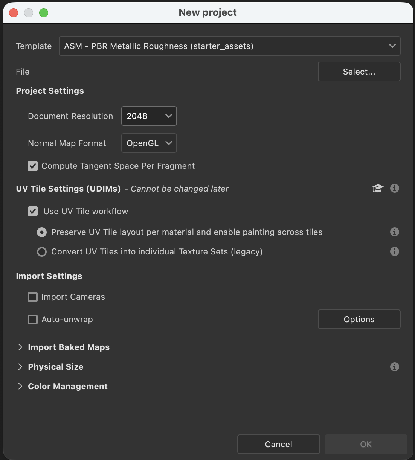

# Jour 1 – Texturer avec Substance 3D Painter

## Objectifs du jour

- Comprendre le rôle de Substance 3D Painter dans une chaîne de production 3D.
- Comprendre les principes physiques du PBR (métal ou non-métal, Fresnel, rugosité).
- Connaître les canaux d’un matériau PBR, leurs valeurs réalistes et à quoi sert chacun.
- Préparer et exporter un modèle depuis Cinema 4D (UVs, FBX).
- Importer le modèle dans Painter, calculer les mesh maps, peindre et appliquer des smart materials.
- Réimporter les textures dans Cinema 4D pour Redshift.

## Qu’est-ce que Substance 3D Painter ?

Painter fait partie de la suite **Adobe Substance 3D**, avec deux autres logiciels :

- **Designer** : crée des textures **procédurales**, c’est-à-dire calculées à partir de règles plutôt que dessinées.
- **Sampler** : crée des textures à partir de **photos** (un mur, un sol, un tissu photographié).
- **Painter** : **peint** ces textures directement sur un modèle 3D, comme on peindrait une figurine.

Painter est l’outil de référence pour texturer un objet unique et détaillé : usure sur les arêtes, saleté dans les creux, rayures, logos placés précisément.

## Prise en main avec les projets d’exemple

Le plus simple pour découvrir Painter est d’ouvrir un projet d’exemple fourni avec le logiciel.

1. Ouvrez le projet **MeetMat** (le petit personnage mascotte de Substance) et manipulez-le librement.
2. Créez un **calque de peinture** (Paint Layer) et peignez dessus au pinceau.
3. Observez les **UVs** : basculez entre la vue 3D seule, la vue 2D seule (les UVs à plat) et les deux vues côte à côte. Un coup de pinceau dans une vue apparaît dans l’autre.
4. Glissez quelques **Smart Materials** sur le modèle et observez : la rouille se loge dans les creux, l’usure apparaît sur les arêtes.
5. Parcourez la liste des **canaux de texture** disponibles.

**Navigation dans la vue 3D** : comme dans Cinema 4D. `Alt + clic gauche` pour tourner, `Alt + clic molette` pour se déplacer, `Alt + clic droit` pour zoomer. Aide Adobe : [Viewport](https://experienceleague.adobe.com/en/docs/substance-3d-painter/using/interface/viewport/viewport).

## Comprendre le PBR en 5 idées

Le PBR (Physically Based Rendering, rendu physiquement réaliste) est une **méthode**, pas une norme stricte : le shader applique les lois de la lumière, et l’artiste fournit des cartes qui décrivent la surface. Résultat : un matériau juste reste crédible **sous n’importe quel éclairage**, et plusieurs artistes obtiennent des résultats cohérents.

**1. La lumière est réfléchie ou pénètre la matière.** Quand un rayon touche une surface, une partie rebondit (la **réflexion spéculaire**, le reflet) et une partie entre dans la matière. Celle qui entre est diffusée à l’intérieur puis ressort presque au même endroit : c’est la **réflexion diffuse**, qui donne la couleur de l’objet. Une pomme paraît rouge parce qu’elle absorbe les autres couleurs et ne renvoie que le rouge.

**2. La rugosité étale le reflet, sans changer sa quantité.** À l’échelle microscopique, une surface est faite de minuscules facettes (**micro-facettes**). Si elles sont alignées, le reflet est net et intense ; si elles sont désordonnées, le reflet est plus large et plus terne. Mais **la quantité totale de lumière réfléchie reste la même**. C’est exactement ce que décrit la carte Roughness.

**3. La conservation de l’énergie.** Une surface ne renvoie jamais plus de lumière qu’elle n’en reçoit. Bonne nouvelle : c’est le shader qui s’en charge, pas l’artiste.

**4. L’effet Fresnel.** Plus on regarde une surface en angle rasant, plus elle reflète. Face à un lac, on voit le fond ; en regardant loin vers l’horizon, on ne voit plus que le reflet du ciel. De face, la part réfléchie s’appelle le **F0** :

- **Non-métaux** (plastique, bois, peau, pierre…) : environ **2 à 5 %** de reflet de face (4 % en moyenne), jusqu’à presque 100 % en angle rasant. Le reflet n’est **jamais coloré**.
- **Métaux** : **70 à 100 %** de reflet, et ce reflet peut être **teinté** (l’or reflète en jaune). Toute la lumière qui pénètre un métal est absorbée : **un métal n’a pas de couleur diffuse**, sa couleur vient de son reflet.

Là encore, le shader gère le Fresnel : on ne le peint pas.

**5. Métal ou non-métal : la première question à se poser.** Avant de texturer, demandez-vous : **est-ce du métal brut ?** Un métal **peint**, **rouillé** ou couvert de **saleté** n’est plus du métal brut : ces zones se traitent comme un non-métal. Seul le métal mis à nu (sous une peinture écaillée, par exemple) est « métal ».

{: .w75}
*« La surface est-elle métallique ? » : l’arbre de décision du flux Metal/Roughness. À gauche (métal) : Base Color = couleur du reflet, 180 à 255 sRGB. À droite (non-métal) : Base Color entre 30-50 et 240 sRGB, reflet fixe de 4 %. — Source : *The PBR Guide*, Allegorithmic/Adobe, fig. 60.*

Aide Adobe : [Glossary](https://experienceleague.adobe.com/en/docs/substance-3d-painter/using/getting-started/glossary).

## Les canaux d’un matériau PBR

Un matériau PBR (Physically Based Rendering, rendu physiquement réaliste) n’est pas une seule image : c’est un ensemble de **cartes** (maps), chacune décrivant une propriété physique de la surface.

| **Canal**                  | **Ce qu’il décrit**                          | **Lecture de la carte**                            |
|----------------------------|----------------------------------------------|----------------------------------------------------|
| **Color** (Base Color)     | La couleur de base, sans ombre ni reflet     | Image en couleur                                   |
| **Roughness** (rugosité)   | La netteté des reflets                       | Noir = miroir net ; blanc = reflet très flou, mat  |
| **Metallic** (métallicité) | Métal ou non                                 | Blanc (1) = métal ; noir (0) = non-métal           |
| **Normal**                 | Les détails très fins (pores, micro-rayures) | Image bleu-violet, simule le relief par la lumière |
| **Height** (hauteur)       | Les détails plus marqués (creux, bosses)     | Niveaux de gris : clair = haut, sombre = creux     |

**Deux familles de matériaux opaques.** Un matériau est soit **métallique** (Metallic = 1 : acier, or, cuivre, aluminium), soit **non métallique** (Metallic = 0 : cuir, peau, plastique, pierre, bois, peinture…). Les valeurs intermédiaires sont rares : elles servent surtout aux transitions (métal rouillé, métal sous une couche de poussière).

## Des valeurs réalistes pour chaque carte

Dans le flux **Metallic / Roughness** (celui de Redshift et de Painter), la carte Metallic agit comme un **masque** : là où elle est noire, le shader lit la Base Color comme une couleur diffuse avec un reflet fixe de 4 % ; là où elle est blanche, il lit la Base Color comme la **couleur du reflet métallique**.

| **Carte**                  | **Règle pratique**                                                                                                                                    | **Valeurs repères (sur 255, sRGB)**                  |
|----------------------------|-------------------------------------------------------------------------------------------------------------------------------------------------------|------------------------------------------------------|
| **Base Color, non-métal**  | Aucune lumière ni ombre peinte dedans. Contraste plus faible qu’une photo. Du charbon (très sombre) à la neige fraîche (très claire).                 | Jamais sous **30 à 50**, jamais au-dessus de **240** |
| **Base Color, métal brut** | C’est la couleur du reflet : claire et saturée pour l’or ou le cuivre, neutre pour l’acier.                                                           | **180 à 255** (70 à 100 % de reflet)                 |
| **Metallic**               | Presque toujours binaire : 0 ou 1. Des gris de transition seulement pour une fine couche de saleté ou d’oxydation.                                    | Métal brut : **235 à 255** ; non-métal : **0**       |
| **Roughness**              | La carte la plus créative : elle raconte l’histoire de la surface (neuve, manipulée, exposée aux intempéries ?). Partez des détails de la normal map. | Noir = lisse et brillant ; blanc = rugueux et mat    |

**Deux erreurs classiques** (exemples du *PBR Guide*) :

- La saleté laissée en **blanc** dans la carte Metallic : le shader la traite comme du métal brillant.
- Un métal avec une Base Color **trop sombre** : il ne reflète plus assez pour paraître métallique.

{: .w75}
*Cartes correctes (en haut) et incorrectes (en bas). 1 : la saleté est marquée comme métal brut dans la carte Metallic. 2 : le reflet du métal est trop sombre dans la Base Color. La carte de couleurs à droite est le résultat du filtre PBR Validate. — Source : *The PBR Guide*, Allegorithmic/Adobe, fig. 64.*

Quand la carte Metallic descend sous 235 (métal sale, oxydé), baissez aussi la Base Color à cet endroit : on passe progressivement d’un reflet métallique à un reflet de non-métal.

**L’occlusion ambiante (AO)** assombrit les zones peu exposées à la lumière ambiante (creux, recoins). Elle doit rester un **canal séparé** : ne la « cuisez » pas dans la Base Color. Elle n’agit que sur la lumière diffuse, pas sur les reflets.

**Normal ou Height ?** La **normal map** porte les détails fins, à haute fréquence (pores, micro-rayures). La **height map** décrit plutôt la **silhouette des formes** (creux, bosses). En rendu temps réel on la garde plutôt douce ; en rendu raytracé avec du displacement (Redshift), elle peut contenir du détail.

**Le liseré blanc.** À la frontière entre un métal très clair et un non-métal sombre, un fin liseré blanc peut apparaître : c’est le mélange des pixels voisins. Il se voit surtout en basse résolution. Le meilleur remède : des UVs assez grands pour offrir une bonne **densité de texels** (nombre de pixels de texture par centimètre de surface).

**Vérifier ses valeurs dans Painter.** Le filtre **PBR Validate** (Metal/Roughness) affiche une carte de chaleur : **vert ou jaune = valeurs correctes, rouge = hors limites** (Base Color trop sombre ou trop claire, reflet métallique trop faible). S’il n’est pas dans votre étagère, cherchez-le sur Substance 3D Community Assets (ex-Substance Share).

**Des calques, comme dans Photoshop, mais sur plusieurs canaux.** Les calques de Painter s’empilent et se mélangent comme dans Photoshop. La différence : **chaque calque contient potentiellement tous les canaux** (couleur, rugosité, métal, hauteur…). On active seulement ceux dont on a besoin. Par exemple, un calque de rayures peut ne toucher qu’à la hauteur et à la rugosité, sans changer la couleur. Chaque calque a même son **mode de fusion et son opacité par canal**.

**Les types de calques** (aide Adobe : [Layer stack](https://experienceleague.adobe.com/en/docs/substance-3d-painter/using/interface/layer-stack/layer-stack)) :

- **Calque de peinture (Paint Layer)** : on peint dessus au pinceau ou avec des particules.
- **Calque de remplissage (Fill Layer)** : on ne peint pas dessus ; on y charge un matériau ou des valeurs qui remplissent les canaux. On contrôle ensuite où il apparaît avec un **masque**.
- **Dossier (Folder)** : range et regroupe des calques.
- **Instance** : réutilise les réglages d’un calque ailleurs.

**Les masques** fonctionnent comme dans Photoshop : blanc = visible, noir = caché. Dans un masque, on peut empiler des **effets** : **générateurs** (masques automatiques qui lisent les mesh maps : arêtes, creux, poussière…), **filtres**, **niveaux**. C’est le cœur du texturage non destructif : on règle, on revient en arrière, sans jamais repeindre.

## Des UVs propres : un prérequis obligatoire

Painter peint sur une image 2D qui est ensuite « posée » sur le modèle grâce aux **UVs** (les coordonnées qui relient chaque point du modèle à un point de l’image). Sans UVs propres, la peinture s’étire, se répète ou déborde. Le principe du dépliage est détaillé au Jour 2.

Deux solutions pour obtenir des UVs :

- **Dépliage automatique dans Painter** : le plus facile, et le résultat fonctionne. Mais la qualité est moyenne et on n’a aucun contrôle : impossible de corriger.
- **Dépliage dans Cinema 4D** : un peu plus délicat, mais de meilleure qualité, et on peut intervenir à la main.

## Exporter un maillage pour Painter

**Méthode la plus simple : un seul objet.**

1. **Rassemblez tout l’objet en une seule géométrie** (sélection des objets, puis Connecter les objets et supprimer (Connect Objects + Delete)).
2. **Surveillez le nombre de polygones.** N’exportez pas la version lissée : on appliquera la Surface de subdivision (SDS) après la peinture, dans Cinema 4D.
3. **Dépliez les UVs automatiquement** (voir Jour 2).
4. **Rangez les UVs avec le Packing** : les îlots UV sont disposés au mieux dans le carré de texture. Aide Maxon : [Optimal mapping (Packed)](https://help.maxon.net/c4d/en-us/Content/html/11657.html), [UV Packing](https://help.maxon.net/c4d/en-us/Content/html/71753.html).
5. **Règle absolue :** les UVs ne doivent **jamais se chevaucher** et doivent tous rester **à l’intérieur de l’espace UV** (le carré 0-1). Sinon, deux zones du modèle partageraient les mêmes pixels : un coup de pinceau apparaîtrait à deux endroits.
6. **Exportez en FBX** (Fichier \> Exporter \> FBX). Vous pouvez limiter l’export à la sélection. Ne modifiez aucun autre paramètre.

{: .w40}
*Les réglages d’export FBX de Cinema 4D : on garde les options par défaut. — Document d'origine*

## Créer le projet dans Painter

À l’ouverture du FBX (Fichier \> Nouveau), réglez la fenêtre **Nouveau projet** avec soin :

- **Modèle (Template)** : PBR – Metallic Roughness. C’est le flux de travail compatible avec Redshift.
- **Résolution du document** : au moins **2048** pixels. Elle reste modifiable plus tard, par Texture Set (jusqu’à 4K pendant le travail, 8K à l’export).
- **Format de normal map** : **OpenGL** (axe Y vers le haut). C’est le format attendu par Redshift. Le format **DirectX** (axe Y inversé) sert surtout aux moteurs de jeu comme Unreal ; avec Redshift, le relief paraîtrait inversé (creux à la place des bosses).
- **UDIM (UV Tile workflow)** : cochez-le si vos UVs utilisent plusieurs cases. L’option **Preserve UV Tile layout** garde toutes les cases d’un matériau dans un même Texture Set, et l’on peint d’une case à l’autre sans couture. Attention : ce choix ne peut plus être changé ensuite.
- **Auto-unwrap** : si le modèle a déjà ses UVs, **ne cochez pas** le dépliage automatique.

Aide Adobe : [Project Creation](https://experienceleague.adobe.com/en/docs/substance-3d-painter/using/getting-started/project-creation), [Project configuration](https://experienceleague.adobe.com/en/docs/substance-3d-painter/using/interface/project-configuration).

{: .w40}
*La fenêtre Nouveau projet de Painter : modèle PBR Metallic Roughness, résolution 2048, normales OpenGL. — Document d'origine*

## Calculer les mesh maps (baking)

Les **mesh maps** sont des cartes calculées à partir de la forme du modèle : occlusion ambiante (AO, les zones peu exposées à la lumière), courbure (les arêtes), épaisseur, position… Les smart materials s’en servent pour savoir où placer la rouille, l’usure ou la poussière.

1. Passez en mode **Baking** (menu Mode, ou `F8`).
2. Choisissez les Texture Sets à calculer et les cartes voulues. Inutile de calculer la carte **ID**.
3. Sans modèle haute définition séparé, cochez **Use Low Poly Mesh as High Poly Mesh** : Painter calcule les cartes à partir du modèle lui-même.
4. Pour une **AO** plus propre, augmentez si besoin le nombre de rayons (Secondary Rays).
5. Lancez le calcul, puis **vérifiez la qualité** de chaque carte et consultez le **journal de baking** (Baking Log) en cas d’erreur.

Si vous projetez les détails d’un modèle haute définition sur un modèle léger, une **cage** (une copie gonflée du modèle) guide le calcul : réglez ses distances avant et arrière pour supprimer les taches rouges d’intersection.

Aide Adobe : [How to bake mesh maps](https://experienceleague.adobe.com/en/docs/substance-3d-painter/using/baking/how-to-bake-mesh-maps).

## Peindre et appliquer des smart materials

- Un **Smart Material** n’est qu’un assemblage de calques de matériaux, avec des **filtres** et des **générateurs** (masques automatiques qui lisent les mesh maps).
- **Ils ne fonctionnent que si les mesh maps ont été calculées.** Sans baking, un matériau « usé » paraît uniforme.
- Ouvrez un smart material (flèche du dossier) pour comprendre sa recette et l’ajuster : c’est la meilleure façon d’apprendre.
- Un smart material **s’adapte à la forme** de chaque modèle : le même « métal usé » placera l’usure sur les arêtes d’un casque comme sur celles d’une caisse.
- **Créer le vôtre** : rangez vos calques dans un dossier, clic droit sur le dossier \> **Create smart material**. Il prend le nom du dossier et rejoint votre étagère.
- Un **Smart Mask** est la même idée pour un masque seul : clic droit sur un calque \> **Create smart mask**.
- Une fois le smart material posé sur le modèle, il devient une simple pile de calques : le modifier dans l’étagère ne met pas à jour les projets existants.

Aide Adobe : [Smart Materials and Masks](https://experienceleague.adobe.com/en/docs/substance-3d-painter/using/features/smart-materials-and-masks).

## Exporter les textures

La fenêtre d’export s’ouvre par Fichier \> Exporter les textures (`Ctrl + Shift + E`). Les **modèles de sortie** (Output templates) décident du nom des fichiers, du regroupement des canaux et du format. Painter en fournit pour les principaux moteurs de rendu, dont Redshift. Aide Adobe : [Export](https://experienceleague.adobe.com/en/docs/substance-3d-painter/using/export/export).

Deux solutions :

- **Images séparées en PNG ou EXR** : une image par canal. Il faut ensuite les brancher correctement dans Redshift (voir Jour 2, « Brancher les textures »).
- **Fichier SBSAR** (format proposé à l’export depuis Painter 8.2) : toutes les textures dans un seul fichier, importé en une fois dans Cinema 4D. Beaucoup plus pratique. **Attention :** non compatible avec les UDIM. Aide Maxon : [Substance 3D Material (Redshift)](https://help.maxon.net/c4d/en-us/Content/html/Substance_3D_Material_Redshift.html).

Dans les deux cas, on peut corriger le matériau après coup dans l’éditeur de nœuds de Redshift (Node Editor) : ajuster une couleur, doser la rugosité…

## Aller plus loin : plusieurs objets, plusieurs matériaux

Tout fusionner en un objet et un matériau est simple, mais limité. On peut garder les pièces séparées, ce qui permet de les **animer** ensuite (une roue qui tourne, un couvercle qui s’ouvre).

**Painter ne raisonne qu’en matériaux**, pas en objets :

- 8 objets avec **un seul** matériau : Painter ne voit **qu’un seul** ensemble de textures (Texture Set).
- 1 objet avec **8** matériaux : Painter voit **8** ensembles séparés.

L’aide Adobe le confirme : Painter crée un **Texture Set pour chaque matériau** (Material ID) trouvé dans le fichier, et chacun doit avoir ses propres UVs. Aide Adobe : [Texture Set](https://experienceleague.adobe.com/en/docs/substance-3d-painter/using/interface/texture-set/texture-set).

Donc, pour séparer les pièces dans Painter, on leur applique **des matériaux différents** dans Cinema 4D. Un même objet peut avoir plusieurs matériaux grâce aux **sélections de polygones** (on sélectionne des faces, on mémorise la sélection, puis on la glisse dans le champ Sélection du tag Matériau).

**Attention :** à l’intérieur d’un même matériau, les UVs ne doivent toujours pas se chevaucher.

## Points de vigilance

- Pas d’UVs propres, pas de Painter.
- UVs qui se chevauchent ou qui sortent du carré 0-1 = peinture à deux endroits.
- Normal map en OpenGL pour Redshift.
- Pas de baking = smart materials sans effet.
- SBSAR et UDIM ne sont pas compatibles.
- Métal brut ou non ? Peinture, rouille et saleté = non-métal.
- Base Color d’un non-métal entre 30-50 et 240 ; pas d’ombre ni d’AO peinte dedans.
- Un doute sur les valeurs ? Filtre PBR Validate.
