# Jour 2 – UVs, branchement des textures et matériaux dans Cinema 4D

## Objectifs du jour

- Comprendre le principe du dépliage UV et prendre en main le nouvel éditeur UV (Cinema 4D 2026.3).
- Savoir déplier un objet simple : Automatic UV, UV Projection, coutures et UV Unwrap and Relax.
- Réaliser un projet complet Cinema 4D → Painter → Cinema 4D (le casque).
- Brancher correctement des textures PBR dans un matériau Redshift.
- Texturer directement dans Cinema 4D avec des textures procédurales.
- Créer des matériaux de verre réalistes.

## Le dépliage UV : emballer un cadeau

Déplier des UVs, c’est comme **emballer un cadeau** avec une feuille de papier qui doit recouvrir parfaitement un volume.

- Pour un **cube**, c’est facile : six faces plates.
- Pour un **ballon**, c’est compliqué : une feuille plate ne recouvre pas une sphère sans plis.

Il faut donc **découper le papier** en plusieurs morceaux. Les lignes de découpe s’appellent des **coutures (seams)**. Chaque morceau déplié forme un **îlot UV** (UV island).

**À quoi servent les UVs ?** Une texture est une image plate. Les UVs disent, pour chaque point du modèle, quelle zone de l’image doit y apparaître : la forme 3D est convertie en un **dépliage 2D** sur lequel on cale les textures. Les projections simples d’un tag Matériau (cylindrique, sphérique, cubique…) suffisent pour des formes simples, mais dès qu’une texture doit apparaître **sans déformation** sur une partie précise de l’objet, il faut des UVs. Autre avantage : une projection UV **reste collée à la surface** quand l’objet se déforme, ce qui est indispensable pour un personnage animé. Des UVs étirés = une texture étirée.

Aide Maxon : [The UV Editor and Its Tools](https://help.maxon.net/c4d/en-us/Content/html/UV_Editor_Overview.html).

## L’éditeur UV de Cinema 4D

**Cinema 4D 2026.3** a introduit un **éditeur UV entièrement nouveau**, avec de nouveaux outils. L’ancien éditeur et les outils hérités de BodyPaint 3D ont disparu. Les nouveaux outils s’utilisent comme en modélisation, avec les modes **Points**, **Arêtes** et **Polygones**.

**La disposition UVEdit.** En haut à droite de l’interface, choisissez la disposition (layout) **UVEdit**. Elle affiche :

- **L’éditeur UV** (UV Editor) : le dépliage de l’objet sélectionné et de son tag UVW. Le carré marqué de **0,0 à 1,1** est la case UV standard. Des UVs en dehors de ce carré sont permis : ils passent dans les cases voisines (UDIM).
- **La vue 3D**, pour garder l’objet sous les yeux. Les outils de sélection et les outils Déplacer, Tourner, Échelle fonctionnent dans les deux vues. Seul l’effet change : dans la vue 3D on modifie la forme de l’objet, dans l’éditeur UV on modifie seulement la façon dont la texture se pose dessus.
- **Une barre d’outils UV** (en bas de l’éditeur). Toutes les fonctions UV se trouvent aussi dans le menu **Maillage › UV** (Mesh › UV).
- **Le panneau Coordonnées**, sous le Gestionnaire d’attributs : rotation par pas de 90°, déplacement vers une case voisine (Move to tile)…

Chaque modification est enregistrée dans le **tag UVW** de l’objet : on peut revenir à la disposition Standard à tout moment sans rien perdre. Pour éditer des UVs existants, il suffit de sélectionner le tag UVW de l’objet dans le Gestionnaire d’objets.

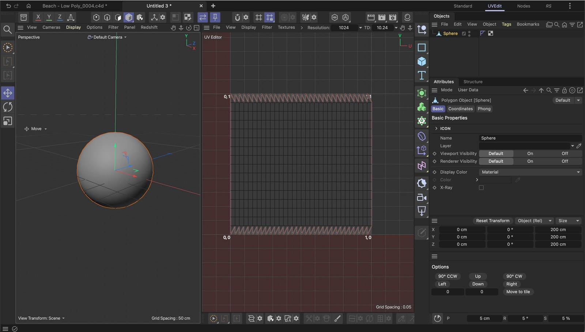{: .w100}
*La disposition UVEdit. Une sphère primitive convertie en polygones arrive avec des UVs sphériques : la grille est étirée aux pôles (dents de scie en haut et en bas). — Capture Cinema 4D*

## Créer des UVs : trois façons de faire

### 1. Automatic UV : tout en un clic

**Automatic UV** crée en une seule étape un dépliage **sans chevauchement**, avec des îlots rangés au mieux dans la case 0-1 (dépliage, relâchement puis rangement). Il peut se limiter à une sélection de polygones. En revanche, il **ignore les coutures (Seams) et les épingles (Pins)**. Les réglages s’ouvrent avec l’icône d’engrenage, à côté de la commande. Le paramètre **Unwrap Mode** change radicalement le résultat :

- **Angle** : découpe l’objet là où l’angle entre deux faces dépasse la valeur choisie. Beaucoup de petits îlots.
- **Packed** : un grand îlot qui remplit la case, et des îlots séparés pour les parties qui ne s’aplatissent pas (ici les pôles).
- **Cubic** : découpe selon les six directions d’un cube.

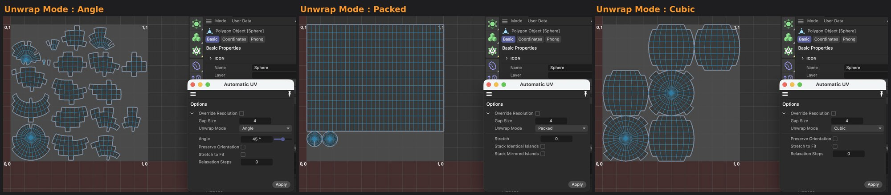{: .w100}
*Automatic UV sur la même sphère : modes Angle, Packed et Cubic. — Captures Cinema 4D*

Aide Maxon : [Automatic UV](https://help.maxon.net/c4d/en-us/Content/html/TOOLAUTOUNWRAP.html).

### 2. UV Projection : les projections classiques

**UV Projection** crée de nouveaux UVs à partir d’une projection standard : plane, cubique, sphérique, frontale, **Vue** (depuis la caméra de travail), **Boîte** (Box)… Le résultat remplace le tag UVW existant ou en crée un nouveau (option *Create New Tag*). C’est souvent un **point de départ**, que l’on découpe et relâche ensuite. Comme Automatic UV, cette fonction **ne tient pas compte des coutures**.

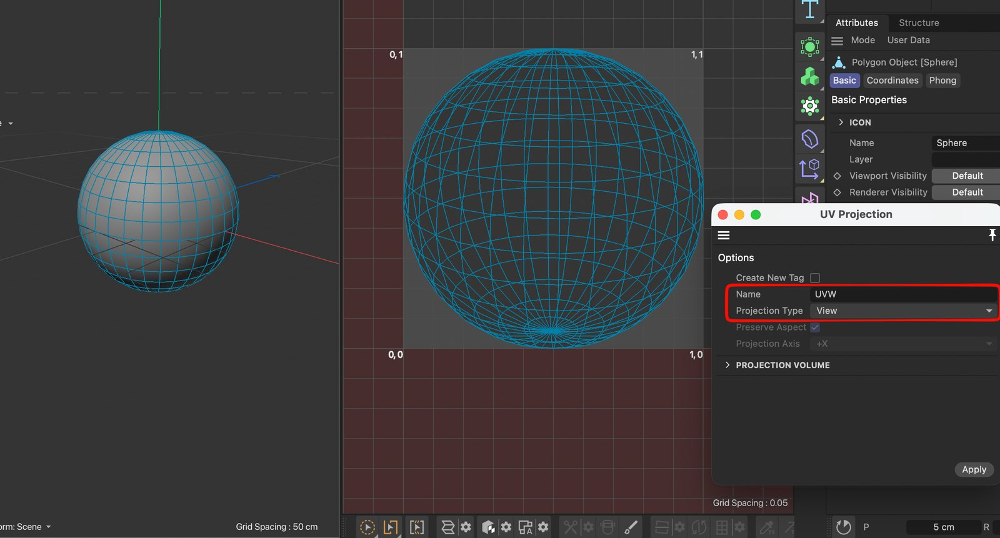{: .w75}
*UV Projection, type Vue : la sphère est « photographiée » depuis la vue 3D, les faces avant et arrière se superposent. — Capture Cinema 4D*

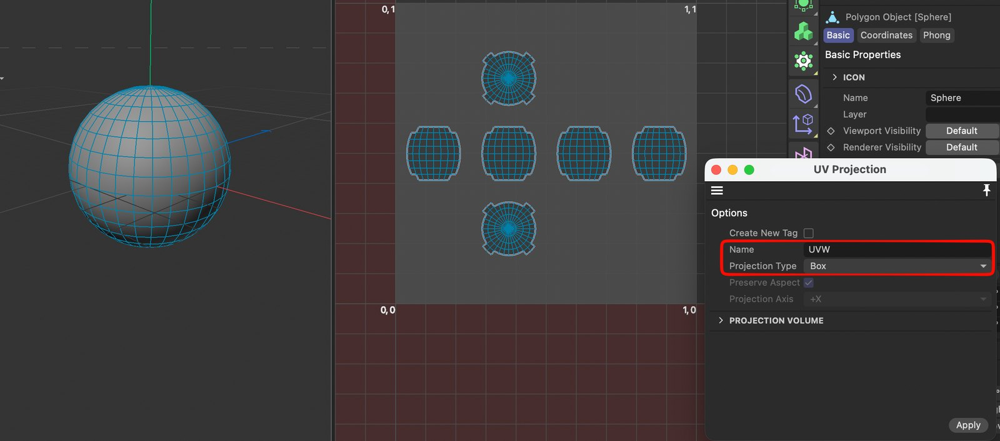{: .w75}
*UV Projection, type Boîte (Box) : six îlots, un par face du cube englobant. — Capture Cinema 4D*

Aide Maxon : [UV Projection](https://help.maxon.net/c4d/en-us/Content/html/TOOLUVPROJECTION.html).

### 3. Coutures + UV Unwrap and Relax : la méthode contrôlée

C’est la méthode de référence, et avec des coutures bien placées, souvent **le seul outil nécessaire**.

1. **Marquer les coutures** avec l’outil **Seam Selection**, en mode Arêtes. Il fonctionne comme la sélection de chemin d’arêtes (Path Selection) : on peut sélectionner des boucles entières, ou utiliser le mode *Live Path* en maintenant le clic gauche et en « peignant » le long des arêtes. On peut s’arrêter pour tourner la vue, puis reprendre. `Ctrl` (`Cmd` sur Mac) retire des coutures. Les coutures sont stockées dans un **tag de sélection d’arêtes** spécial, ajouté automatiquement à l’objet.
2. **Déplier avec UV Unwrap and Relax** : l’outil ouvre le maillage le long des coutures, puis **relâche** le dépliage pour que les proportions des polygones UV suivent au plus près celles des polygones 3D. Il tient compte des coutures **et** des épingles, et peut se limiter aux polygones sélectionnés.
3. **Orienter et placer** : **Align UV Island** tourne un îlot pour l’aligner sur l’arête cliquée. En mode Polygones, un **double-clic** sélectionne un îlot entier ; en mode Arêtes, une boucle. Les outils Déplacer, Tourner et Échelle font le reste.



Aide Maxon : [Seam Selection](https://help.maxon.net/c4d/en-us/Content/html/TOOLSEAMSELECTION.html), [UV Unwrap and Relax](https://help.maxon.net/c4d/en-us/Content/html/TOOLUVUNWRAP.html).

## Retoucher un dépliage

**Séparer et recoudre des îlots.**

- **Disconnect UVs** transforme les polygones UV sélectionnés en un îlot indépendant (ou coupe le long des arêtes sélectionnées), avec un écart réglable dans l’engrenage.
- **UV Weld** recoud des arêtes : survolez une arête sélectionnée dans l’éditeur UV, des flèches indiquent le sens de la soudure. Maintenez `Shift` pour déplacer tout l’îlot, et pas seulement les arêtes. C’est l’équivalent UV de l’outil Coudre (Stitch and Sew).
- Astuce : **Sélection › Sélection du contour** (Outline Selection) sélectionne d’un clic la bordure d’une sélection de polygones, à la fois sur l’îlot détaché et sur l’îlot principal.



**Ajustements locaux.**

- **Sélection douce** (Soft Selection) : déplacer quelques points UV entraîne aussi leurs voisins, avec une atténuation réglable.
- **Épingles (Pins)** : elles bloquent les points UV déjà bien placés. Un nouveau relâchement avec **UV Unwrap and Relax** les respecte et ne redistribue que le reste.
- `S` cadre la sélection dans l’éditeur UV, comme dans la vue 3D. Fichier › Ouvrir une texture (dans l’éditeur UV) affiche une image en fond pour caler les UVs dessus.



**Les outils de modélisation fonctionnent aussi en UV** : sélections (Pinceau, Rectangle, Lasso, Boucle, Anneau, Contour, Remplissage, Chemin), Déplacer, Tourner, Échelle, sélection douce, Pinceau, Aimant, Fer à repasser (Iron), Glisser (Slide), Égaliser l’espacement, Lisser ou Redresser des arêtes…

Aide Maxon : [Disconnect UVs](https://help.maxon.net/c4d/en-us/Content/html/TOOLUVDISCONNECT.html), [UV Weld](https://help.maxon.net/c4d/en-us/Content/html/TOOLUVWELD.html).

## Exercice : déplier une orange

On déplie une sphère comme on éplucherait une orange : deux capuchons et une bande.

1. **Préparer** : créez une Sphère, rendez-la éditable (`C`) et passez dans la disposition **UVEdit**.
2. **Les coutures** : avec **Seam Selection**, en mode Arêtes, sélectionnez une boucle près de chaque pôle, puis un méridien qui les relie. L’option *Loop Stop at Seams* arrête la sélection de boucle sur les coutures existantes.

   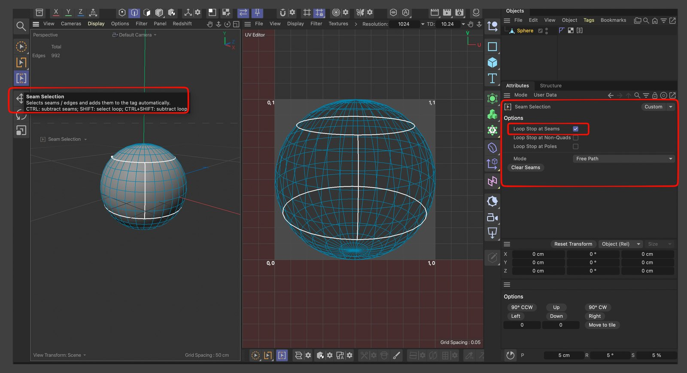{: .w75}
   *Seam Selection : les coutures (en blanc) autour des pôles et le long d’un méridien. — Capture Cinema 4D*

3. **Déplier** : lancez **UV Unwrap and Relax** avec l’option **Pack Islands** cochée. On obtient deux disques (les capuchons) et une bande courbe.

   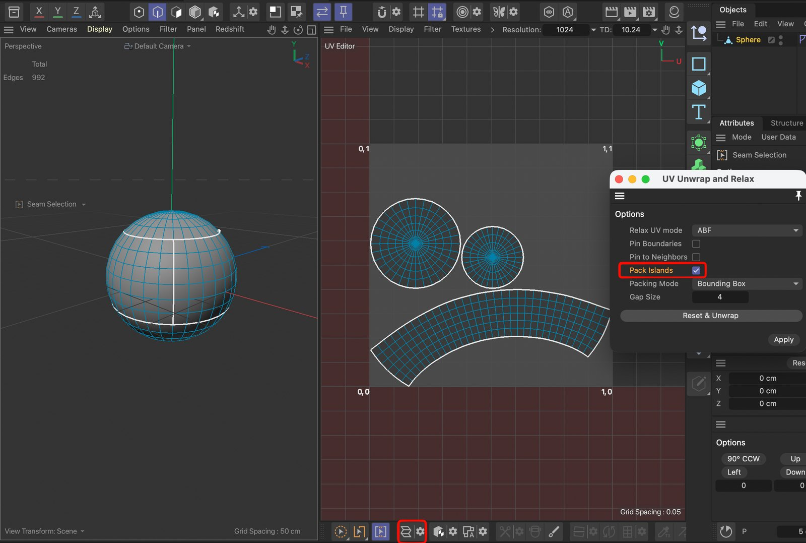{: .w75}
   *UV Unwrap and Relax, option Pack Islands : deux capuchons et la bande de la sphère. — Capture Cinema 4D*

4. **Redresser la bande** : sélectionnez-la (double-clic en mode Polygones), puis **UV Rectangularize** : les polygones à quatre côtés deviennent une grille parfaitement rectangulaire, idéale pour une texture qui doit rester droite (une étiquette, un motif rayé).

   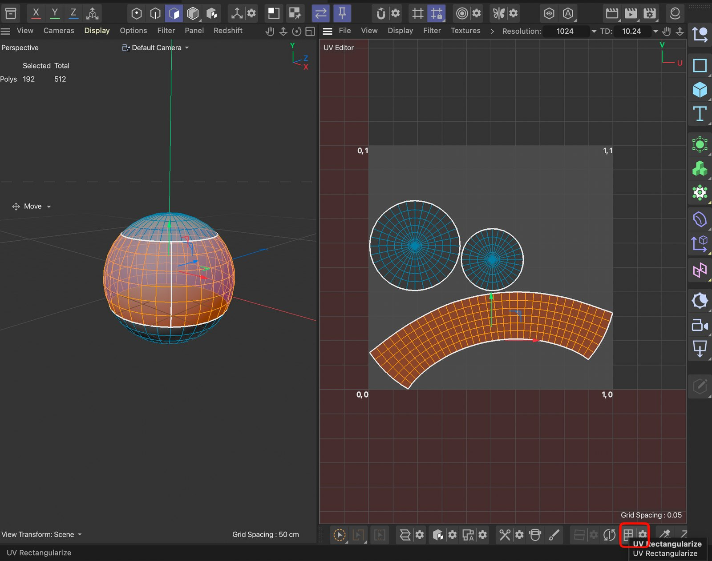{: .w75}
   *UV Rectangularize : la bande courbe devient un rectangle régulier. — Capture Cinema 4D*

5. **Placer les îlots** : déplacez, tournez ou mettez à l’échelle les îlots avec les outils habituels. À ce stade, ils peuvent se chevaucher ou sortir de la case.

   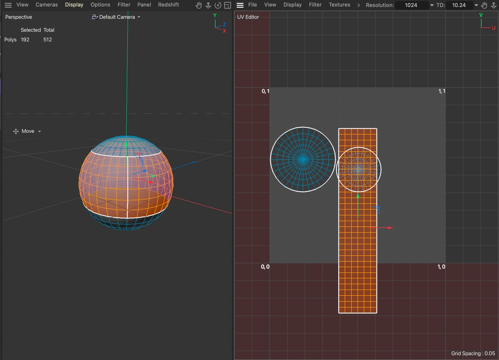{: .w75}
   *L’îlot rectangulaire déplacé avec l’outil Déplacer : il chevauche un capuchon et sort de la case 0-1. — Capture Cinema 4D*

6. **Ranger** : sélectionnez tous les îlots et lancez **UV Packing**. Les îlots sont réorganisés pour occuper au mieux la case, sans en créer de nouveaux. Trois modes : *Rasterized* (rapide, pour beaucoup d’îlots), *Geometric* (le meilleur résultat, mais plus lent) et *Bounding Box* (très rapide, mais il perd plus de place). Chaque clic sur Apply peut donner une disposition différente.

   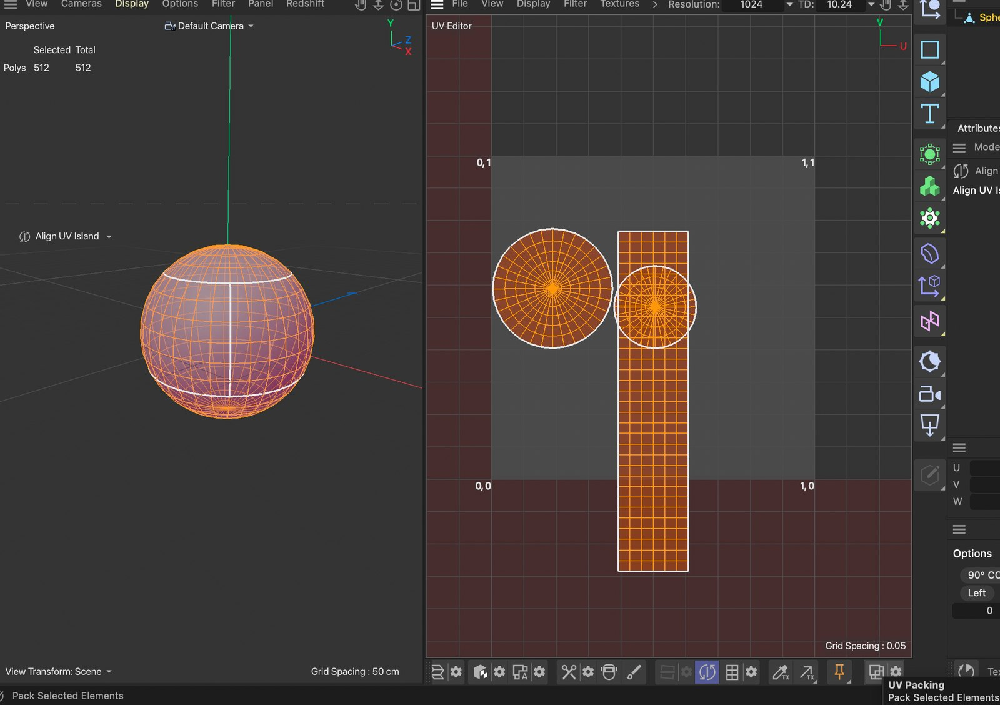{: .w75}
   *Tous les îlots sont sélectionnés, puis UV Packing (Pack Selected Elements). — Capture Cinema 4D*

   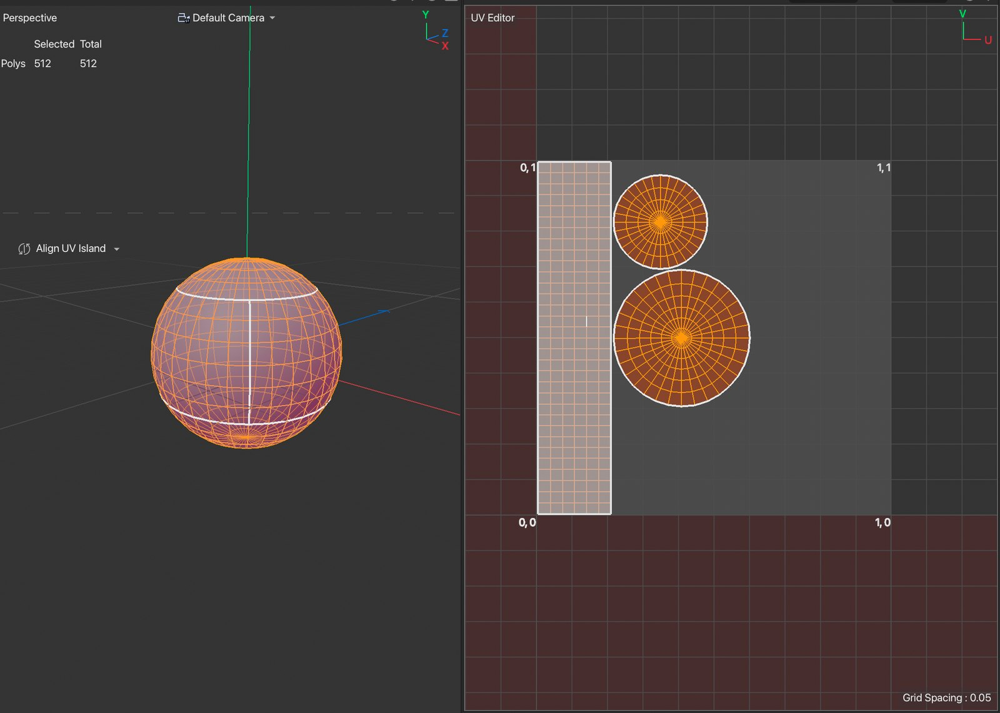{: .w75}
   *Après le rangement : les trois îlots tiennent dans la case 0-1 sans se chevaucher. — Capture Cinema 4D*

7. **Vérifier** : dans l’éditeur UV, menu **Textures › Colored Grid** (ou Checkerboard) affiche une grille de contrôle sur l’objet. Des carrés réguliers = UVs sans déformation. Des carrés étirés = UVs à corriger.

   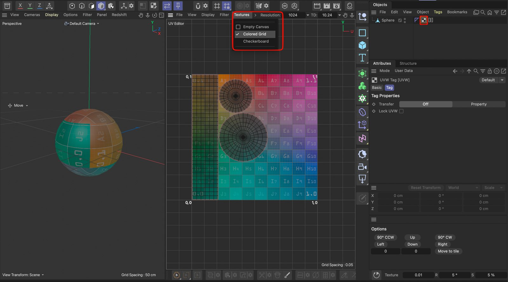{: .w75}
   *Textures › Colored Grid : la grille de contrôle s’affiche dans l’éditeur UV et sur la sphère. — Capture Cinema 4D*

Aide Maxon : [UV Rectangularize](https://help.maxon.net/c4d/en-us/Content/html/TOOLUVRECTANGULARIZE.html), [UV Packing](https://help.maxon.net/c4d/en-us/Content/html/TOOLUVPACKING.html).

## Projet : le casque de football américain

Le casque sert d’exercice complet, de Cinema 4D à Painter puis retour.

**Fichier de départ : [Casque_Start.c4d](fichiers/Casque_Start.c4d)**. Le casque est déjà découpé en **3 objets** : `casque`, `grille` et `attaches`, sans aucun matériau.

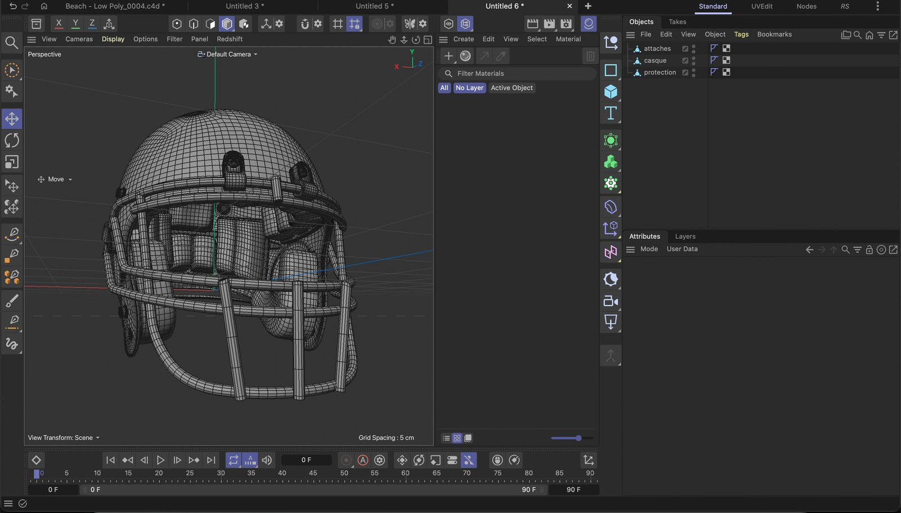{: .w75}
*Le fichier de départ : un casque de football américain modélisé, en trois objets. — Capture Cinema 4D*

1. **Quatre matériaux pour quatre zones** : Painter crée un ensemble de textures (Texture Set) par matériau (voir Jour 1). On prépare donc **4 matériaux** : `Casque`, `Grille`, `Attaches` et `Mousse`.
   - Appliquez `Casque`, `Grille` et `Attaches` sur l’objet du même nom.
   - Pour la mousse, qui fait partie de l’objet `casque` : en mode Polygones, sélectionnez les coussinets, puis **Sélection › Mémoriser la sélection** (Store Selection). Un tag de sélection de polygones apparaît : nommez-le `Mousse`.
   - Appliquez le matériau `Mousse` sur l’objet `casque` et glissez le tag de sélection dans le champ **Sélection** de son tag Matériau.

   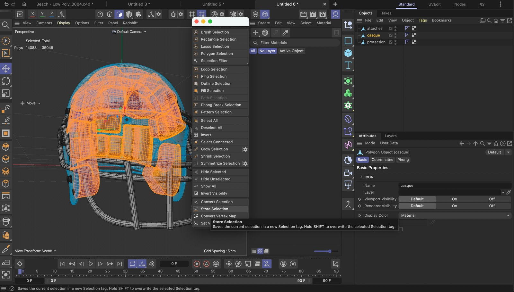{: .w75}
   *Les polygones de la mousse sélectionnés, puis Sélection › Mémoriser la sélection (Store Selection). — Capture Cinema 4D*

   **Fichier avec les 4 matériaux : [Casque4mat.c4d](fichiers/Casque4mat.c4d)**.

   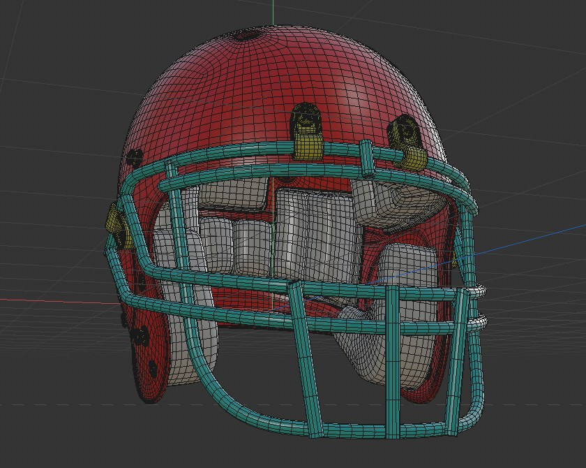{: .w60}
   *Le casque avec ses 4 matériaux : Casque (rouge), Grille (turquoise), Attaches (jaune) et Mousse (blanc). — Capture Cinema 4D*

2. **Déplier et ranger les UVs** de chaque matériau (Automatic UV, ou coutures + UV Unwrap and Relax, puis **UV Packing**). Règle absolue : à l’intérieur d’un même matériau, les UVs ne doivent ni se chevaucher ni sortir de la case 0-1.
3. **Dépliez à la main** les éléments que l’automatique traite mal.
4. **Exportez en FBX** et texturez le casque dans Painter : quatre Texture Sets, smart materials, peinture, logos.
5. **Exportez les textures** en **SBSAR**, **PNG** ou **EXR**, et réimportez-les dans Cinema 4D.

{: .w60}
*Le casque texturé dans Painter, puis rendu dans Cinema 4D. — Document d'origine*

## Brancher les textures dans Redshift

Si vous importez les textures comme images (PNG), chaque carte doit aller au bon endroit **et** avec le bon **espace colorimétrique**. C’est la source d’erreur la plus fréquente.

| **Carte**     | **Où la brancher**                                                 | **Espace colorimétrique**                                                                            |
|---------------|--------------------------------------------------------------------|------------------------------------------------------------------------------------------------------|
| **Color**     | Entrée Base Color du matériau                                      | **sRGB**                                                                                             |
| **Roughness** | Entrée Reflection Roughness                                        | **Raw**                                                                                              |
| **Metallic**  | Entrée Metalness                                                   | **Raw** (souvent inutile si la carte est entièrement blanche ou noire : réglez simplement la valeur) |
| **Normal**    | Nœud **Bump Map**, type **Tangent-Space Normal**, puis entrée Bump | **Raw**                                                                                              |
| **Height**    | Nœud **Bump Map**, type **Height Field**, puis entrée Bump         | **Raw**                                                                                              |

**Pourquoi Raw ?** Les calculs d’éclairage se font en **espace linéaire**. Une carte qui représente une **couleur que l’on voit** (la couleur d’un plastique, la teinte d’un métal) est enregistrée en sRGB et doit être convertie : on la déclare en **sRGB**. Une carte qui représente une **donnée** (rugosité, métal ou non, hauteur) est déjà un nombre entre 0 et 1 : on la déclare en **Raw** (linéaire). Si on lui applique la correction sRGB, les valeurs sont faussées : un roughness de 0,5 deviendrait environ 0,2.

**Combiner Normal et Height.** Un matériau n’a qu’une entrée Bump. Pour utiliser les deux cartes, reliez-les à un nœud **Bump Blender**, cochez le mode **Additif** (Additive Mode) et mettez le poids (weight) de la couche à **1**. Sans mode additif, une couche remplace la précédente au lieu de s’y ajouter.

Aide Maxon : [Bump Map](https://help.maxon.net/c4d/en-us/Content/_REDSHIFT_/html/Bump+Map.html) (qui confirme que Redshift attend des normal maps OpenGL), [Bump Blender](https://help.maxon.net/c4d/en-us/Content/_REDSHIFT_/html/Bump+Blender.html).

{: .w50}
*Les textures de Painter branchées dans l’éditeur de nœuds de Redshift. — Document d'origine*

{: .w50}
*Normal et Height combinées dans un Bump Blender. — Document d'origine*

{: .w50}
*Vue d’ensemble du graphe de nœuds du matériau. — Document d'origine*

## Texturer directement dans Cinema 4D

Pour du métal, du verre ou un plastique simple, **inutile de déplier les UVs** : on peut tout faire dans Cinema 4D avec des textures **procédurales** (calculées, sans image).

**La couleur**

- Pour éviter une couleur parfaitement unie (qui fait « 3D »), mélangez un **Maxon Noise** avec la couleur dans un nœud **Color Layer**. Aide Maxon : [Maxon Noise](https://help.maxon.net/c4d/en-us/Content/_REDSHIFT_/html/Maxon+Noise.html).

**La rugosité (Roughness)**

- Un Maxon Noise a une valeur **moyenne de 0,5** : beaucoup trop mat pour la plupart des matériaux.
- Ramenez ses valeurs dans une plage réaliste, par exemple **0,05 à 0,4**, avec un **Change Range** ou une **Ramp**.
- Affinez avec une **Scalar Ramp** ou un **Color Correct** (gamma). Règle : **plus c’est noir, plus le reflet est net ; plus c’est gris, plus le reflet est terne**.

**Des images d’imperfections**

- À la place du bruit, utilisez une image de la bibliothèque (Médias \> Imperfections de l’Asset Browser).
- Sa luminosité moyenne indique à quel point le matériau sera mat : préférez des images **gris foncé** pour un matériau brillant.
- Sans UVs, appliquez ces images avec la projection **TriPlanar** : elle projette l’image depuis les trois axes et mélange les raccords.
- Le TriPlanar est parfait pour des détails **chaotiques** (taches, rayures aléatoires). Il ne convient pas aux détails **précis** (inscription, logo).

**Le relief (Bump)**

- Réutilisez le même bruit dans un **Bump Map** en mode Height.
- **La règle du toucher** : si en passant le doigt sur la surface je **sens** quelque chose (éraflure, creux, rayure, crépi), c’est du **bump**. Si je ne sens rien, c’est lisse : c’est de la **rugosité**.
- En résumé : **Roughness = saleté, traces de doigts. Bump = rayures, imperfections.**

**Avantages du texturage dans Cinema 4D**

- Aucun souci de géométrie (N-Gons, densité de maillage…).
- Pas d’UVs à déplier.
- Pas d’aller-retour d’export et de réimport.

**Inconvénients**

- Pas de texture complexe (usure réaliste des arêtes, etc.).
- Difficile de placer précisément un détail, une rayure, un logo.
- Plus lourd à calculer au rendu.

Certains matériaux de l’Asset Browser sont de vrais « smart materials » comme dans Painter : très beaux, mais plus longs à calculer.

## Les matériaux de verre

Le verre est **très long à calculer** : prévoyez des tests en basse résolution. Il peut se passer totalement de texture.

**Un verre simple** (Redshift Standard Material)

- **Transmission** (Weight) à **1** : la lumière traverse le matériau.
- **Roughness** vers **0,05** : verre clair.
- **IOR** (indice de réfraction) : il règle la déviation de la lumière qui traverse le matériau. Repères : eau **1,33**, verre à vitre **1,52**. C’est ce qui fait paraître « cassée » une paille plongée dans un verre d’eau.
- Roughness plus élevée : **verre dépoli** ou fumé (encore plus long à calculer).
- Transmission plus basse : la couleur de base se mélange, le verre devient plus opaque.
- Changer la couleur de transmission donne un verre coloré, mais d’aspect peu réaliste.

**Un verre plus réaliste : la profondeur (Depth)**

- Choisissez une couleur de transmission **légèrement teintée** (jamais blanc pur).
- **Depth** indique la distance que parcourt la lumière avant d’être absorbée. Faible valeur = couleur riche et dense ; valeur élevée = verre plus clair.
- Réglez Depth selon l’**épaisseur réelle** de l’objet : plus la lumière traverse de matière, plus elle est absorbée. Un vase épais paraît plus teinté qu’une vitre fine, comme une piscine paraît plus bleue au fond.
- Avec une valeur très faible, le verre devient presque opaque.
- En ajoutant de la **diffusion** (Scatter), l’intérieur du verre se trouble et ressemble à du plastique PVC.
- Pour que la réfraction soit juste, l’objet doit avoir une **épaisseur réelle** (deux faces). Pour une surface sans épaisseur, activez **Thin Walled**.

**La dispersion (aberrations chromatiques)**

- **Dispersion** sépare la lumière en couleurs, comme un prisme : très joli, mais très long à calculer et source de bruit.
- **0 = désactivé.** Ensuite, **plus la valeur est basse, plus l’effet est fort** : 0,0001 est extrême, **10 à 30** donne un effet modéré. L’aide Maxon cite des valeurs typiques à partir de 10 pour le verre.

Aide Maxon : [Standard Material](https://help.maxon.net/c4d/en-us/Content/_REDSHIFT_/html/Standard_Material.html) (sections Transmission et Dispersion).

## Points de vigilance

- Automatic UV et UV Projection ignorent les coutures : pour les utiliser, passez par UV Unwrap and Relax.
- Les UVs d’un même matériau ne se chevauchent pas et restent dans la case 0-1.
- Color en sRGB, toutes les autres cartes en Raw.
- Normal et Height passent par un Bump Map, jamais directement.
- Bump Blender : mode additif et poids à 1.
- Rugosité procédurale : ramenez la moyenne bien sous 0,5.
- Verre : testez petit, le rendu est lent.
