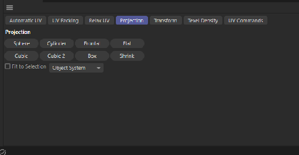
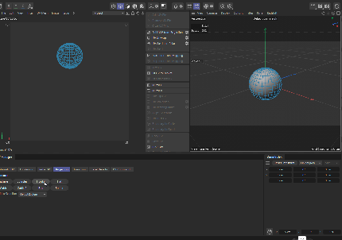
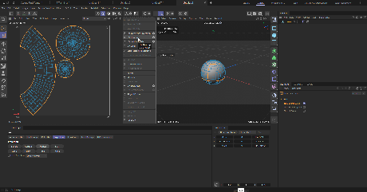
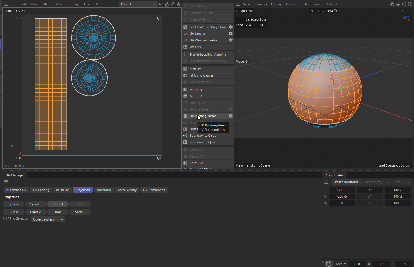
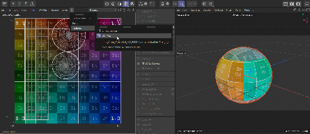
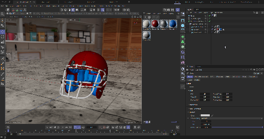
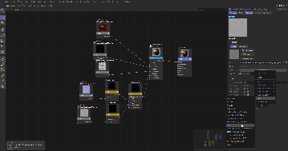
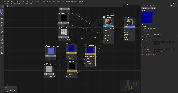
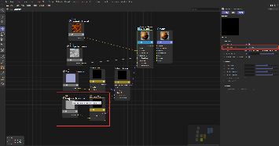

# Jour 2 – UVs, branchement des textures et matériaux dans Cinema 4D

## Objectifs du jour

- Comprendre le principe du dépliage UV et savoir déplier un objet simple.
- Réaliser un projet complet Cinema 4D → Painter → Cinema 4D (le casque).
- Brancher correctement des textures PBR dans un matériau Redshift.
- Texturer directement dans Cinema 4D avec des textures procédurales.
- Créer des matériaux de verre réalistes.

## Le dépliage UV : emballer un cadeau

Déplier des UVs, c’est comme **emballer un cadeau** avec une feuille de papier qui doit recouvrir parfaitement un volume.

- Pour un **cube**, c’est facile : six faces plates.
- Pour un **ballon**, c’est compliqué : une feuille plate ne recouvre pas une sphère sans plis.

Il faut donc **découper le papier** en plusieurs morceaux. Les lignes de découpe s’appellent des **coutures (seams)**. Chaque morceau déplié forme un **îlot UV** (UV island).

**Pourquoi c’est important ?** Une texture est une image plate. Les UVs disent quel pixel de l’image va sur quel point du modèle. Des UVs étirés = une texture étirée.

**Deux approches dans Cinema 4D :**

- **Les projections** : Sphérique, Cylindrique, Frontale, Plate (Flat), Cubique, Boîte (Box), Rétrécissement (Shrink). On « projette » l’image sur l’objet selon une forme simple. Pour des objets simples, cela suffit souvent.
- **Le dépliage par coutures** : on sélectionne les **arêtes** qui serviront de coutures, puis on lance **UV Unwrap** (depuis la 2026.3 : **UV Unwrap and Relax**). L’outil ouvre le maillage le long des coutures et l’aplatit en réduisant les déformations.

Aide Maxon : [L’éditeur UV et ses outils](https://help.maxon.net/c4d/en-us/Content/html/UV_Editor_Overview.html), [UV Unwrap and Relax](https://help.maxon.net/c4d/en-us/Content/html/TOOLUVUNWRAP.html).

{: .w60}
*La palette de projections UV de Cinema 4D : Sphère, Cylindre, Frontal, Plat, Cubique, Boîte, Shrink… — Document d'origine*

## Exercice : déplier une orange

On déplie une sphère comme on éplucherait une orange.

1. **Les capuchons** : sélectionnez les boucles d’arêtes autour des deux pôles et définissez-les comme coutures.

   {: .w60}
   *Les deux capuchons de la sphère, prêts à être séparés. — Document d'origine*

2. **Une projection de départ** : appliquez une projection **Frontale** pour rassembler les UVs en un seul îlot et effacer toute ancienne couture.

   {: .w60}
   *Après la projection frontale, les UVs forment un seul îlot. — Document d'origine*

3. **UV Unwrap** : lancez le dépliage. Les capuchons se séparent et s’aplatissent.
4. **Les quartiers** : sélectionnez de nouvelles arêtes (des méridiens) et relancez **UV Unwrap** pour découper un ou plusieurs quartiers.

   {: .w60}
   *La sphère découpée en quartiers, comme une orange épluchée. — Document d'origine*

5. **Redresser** : **UV Rectangulize** aplatit un îlot en rectangle régulier, idéal pour une texture qui doit rester droite.
6. **Vérifier** : affichez une carte de contrôle (damier UV). Des carrés réguliers = UVs sans déformation. Des carrés étirés = UVs à corriger.

{: .w60}
*La carte de contrôle UV sur la sphère : les carrés doivent rester réguliers. — Document d'origine*

## Projet : le casque de football américain

Le casque sert d’exercice complet, de Cinema 4D à Painter puis retour.

1. Organisez l’export en **3 objets et 4 matériaux** (un matériau par pièce à texturer séparément).
2. Faites un **packing** des UVs de chaque matériau.
3. Dépliez à la main les éléments restants que l’automatique traite mal.
4. Texturez le casque dans Painter (smart materials, peinture, logos).
5. Exportez les textures en **SBSAR**, **PNG** ou **EXR**, et réimportez-les dans Cinema 4D.

{: .w60}
*Le casque texturé dans Painter, puis rendu dans Cinema 4D. — Document d'origine*

## Brancher les textures dans Redshift

Si vous importez les textures comme images (PNG), chaque carte doit aller au bon endroit **et** avec le bon **espace colorimétrique**. C’est la source d’erreur la plus fréquente.

| **Carte**     | **Où la brancher**                                                 | **Espace colorimétrique**                                                                            |
|---------------|--------------------------------------------------------------------|------------------------------------------------------------------------------------------------------|
| **Color**     | Entrée Base Color du matériau                                      | **sRGB**                                                                                             |
| **Roughness** | Entrée Reflection Roughness                                        | **Raw**                                                                                              |
| **Metallic**  | Entrée Metalness                                                   | **Raw** (souvent inutile si la carte est entièrement blanche ou noire : réglez simplement la valeur) |
| **Normal**    | Nœud **Bump Map**, type **Tangent-Space Normal**, puis entrée Bump | **Raw**                                                                                              |
| **Height**    | Nœud **Bump Map**, type **Height Field**, puis entrée Bump         | **Raw**                                                                                              |

**Pourquoi Raw ?** Les calculs d’éclairage se font en **espace linéaire**. Une carte qui représente une **couleur que l’on voit** (la couleur d’un plastique, la teinte d’un métal) est enregistrée en sRGB et doit être convertie : on la déclare en **sRGB**. Une carte qui représente une **donnée** (rugosité, métal ou non, hauteur) est déjà un nombre entre 0 et 1 : on la déclare en **Raw** (linéaire). Si on lui applique la correction sRGB, les valeurs sont faussées : un roughness de 0,5 deviendrait environ 0,2.

**Combiner Normal et Height.** Un matériau n’a qu’une entrée Bump. Pour utiliser les deux cartes, reliez-les à un nœud **Bump Blender**, cochez le mode **Additif** (Additive Mode) et mettez le poids (weight) de la couche à **1**. Sans mode additif, une couche remplace la précédente au lieu de s’y ajouter.

Aide Maxon : [Bump Map](https://help.maxon.net/c4d/en-us/Content/_REDSHIFT_/html/Bump+Map.html) (qui confirme que Redshift attend des normal maps OpenGL), [Bump Blender](https://help.maxon.net/c4d/en-us/Content/_REDSHIFT_/html/Bump+Blender.html).

{: .w50}
*Les textures de Painter branchées dans l’éditeur de nœuds de Redshift. — Document d'origine*

{: .w50}
*Normal et Height combinées dans un Bump Blender. — Document d'origine*

{: .w50}
*Vue d’ensemble du graphe de nœuds du matériau. — Document d'origine*

## Texturer directement dans Cinema 4D

Pour du métal, du verre ou un plastique simple, **inutile de déplier les UVs** : on peut tout faire dans Cinema 4D avec des textures **procédurales** (calculées, sans image).

**La couleur**

- Pour éviter une couleur parfaitement unie (qui fait « 3D »), mélangez un **Maxon Noise** avec la couleur dans un nœud **Color Layer**. Aide Maxon : [Maxon Noise](https://help.maxon.net/c4d/en-us/Content/_REDSHIFT_/html/Maxon+Noise.html).

**La rugosité (Roughness)**

- Un Maxon Noise a une valeur **moyenne de 0,5** : beaucoup trop mat pour la plupart des matériaux.
- Ramenez ses valeurs dans une plage réaliste, par exemple **0,05 à 0,4**, avec un **Change Range** ou une **Ramp**.
- Affinez avec une **Scalar Ramp** ou un **Color Correct** (gamma). Règle : **plus c’est noir, plus le reflet est net ; plus c’est gris, plus le reflet est terne**.

**Des images d’imperfections**

- À la place du bruit, utilisez une image de la bibliothèque (Médias \> Imperfections de l’Asset Browser).
- Sa luminosité moyenne indique à quel point le matériau sera mat : préférez des images **gris foncé** pour un matériau brillant.
- Sans UVs, appliquez ces images avec la projection **TriPlanar** : elle projette l’image depuis les trois axes et mélange les raccords.
- Le TriPlanar est parfait pour des détails **chaotiques** (taches, rayures aléatoires). Il ne convient pas aux détails **précis** (inscription, logo).

**Le relief (Bump)**

- Réutilisez le même bruit dans un **Bump Map** en mode Height.
- **La règle du toucher** : si en passant le doigt sur la surface je **sens** quelque chose (éraflure, creux, rayure, crépi), c’est du **bump**. Si je ne sens rien, c’est lisse : c’est de la **rugosité**.
- En résumé : **Roughness = saleté, traces de doigts. Bump = rayures, imperfections.**

**Avantages du texturage dans Cinema 4D**

- Aucun souci de géométrie (N-Gons, densité de maillage…).
- Pas d’UVs à déplier.
- Pas d’aller-retour d’export et de réimport.

**Inconvénients**

- Pas de texture complexe (usure réaliste des arêtes, etc.).
- Difficile de placer précisément un détail, une rayure, un logo.
- Plus lourd à calculer au rendu.

Certains matériaux de l’Asset Browser sont de vrais « smart materials » comme dans Painter : très beaux, mais plus longs à calculer.

## Les matériaux de verre

Le verre est **très long à calculer** : prévoyez des tests en basse résolution. Il peut se passer totalement de texture.

**Un verre simple** (Redshift Standard Material)

- **Transmission** (Weight) à **1** : la lumière traverse le matériau.
- **Roughness** vers **0,05** : verre clair.
- **IOR** (indice de réfraction) : il règle la déviation de la lumière qui traverse le matériau. Repères : eau **1,33**, verre à vitre **1,52**. C’est ce qui fait paraître « cassée » une paille plongée dans un verre d’eau.
- Roughness plus élevée : **verre dépoli** ou fumé (encore plus long à calculer).
- Transmission plus basse : la couleur de base se mélange, le verre devient plus opaque.
- Changer la couleur de transmission donne un verre coloré, mais d’aspect peu réaliste.

**Un verre plus réaliste : la profondeur (Depth)**

- Choisissez une couleur de transmission **légèrement teintée** (jamais blanc pur).
- **Depth** indique la distance que parcourt la lumière avant d’être absorbée. Faible valeur = couleur riche et dense ; valeur élevée = verre plus clair.
- Réglez Depth selon l’**épaisseur réelle** de l’objet : plus la lumière traverse de matière, plus elle est absorbée. Un vase épais paraît plus teinté qu’une vitre fine, comme une piscine paraît plus bleue au fond.
- Avec une valeur très faible, le verre devient presque opaque.
- En ajoutant de la **diffusion** (Scatter), l’intérieur du verre se trouble et ressemble à du plastique PVC.
- Pour que la réfraction soit juste, l’objet doit avoir une **épaisseur réelle** (deux faces). Pour une surface sans épaisseur, activez **Thin Walled**.

**La dispersion (aberrations chromatiques)**

- **Dispersion** sépare la lumière en couleurs, comme un prisme : très joli, mais très long à calculer et source de bruit.
- **0 = désactivé.** Ensuite, **plus la valeur est basse, plus l’effet est fort** : 0,0001 est extrême, **10 à 30** donne un effet modéré. L’aide Maxon cite des valeurs typiques à partir de 10 pour le verre.

Aide Maxon : [Standard Material](https://help.maxon.net/c4d/en-us/Content/_REDSHIFT_/html/Standard_Material.html) (sections Transmission et Dispersion).

## Points de vigilance

- Color en sRGB, toutes les autres cartes en Raw.
- Normal et Height passent par un Bump Map, jamais directement.
- Bump Blender : mode additif et poids à 1.
- Rugosité procédurale : ramenez la moyenne bien sous 0,5.
- Verre : testez petit, le rendu est lent.
