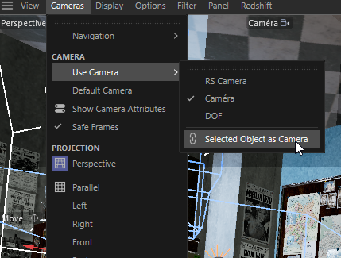
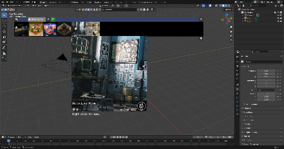
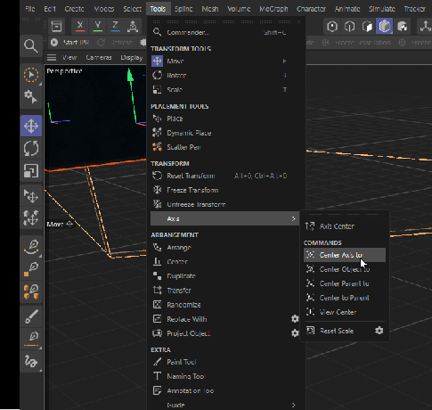
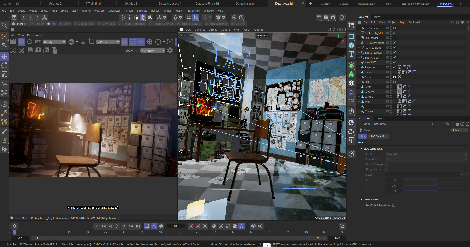
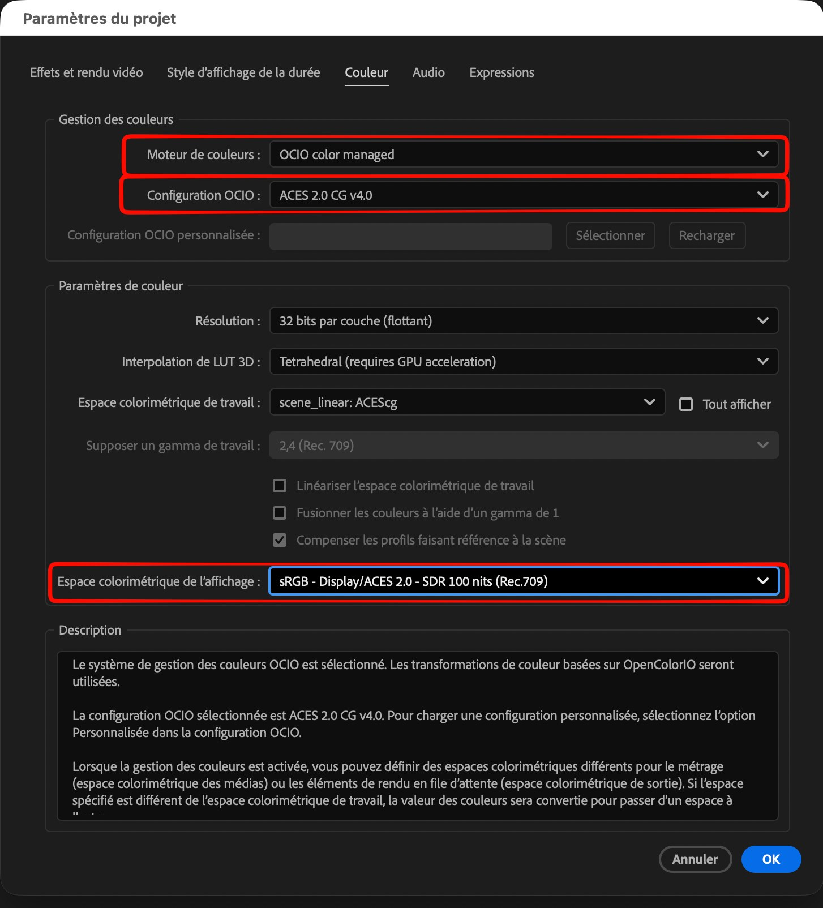
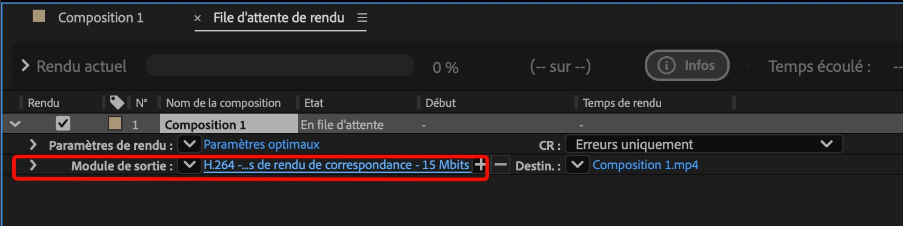
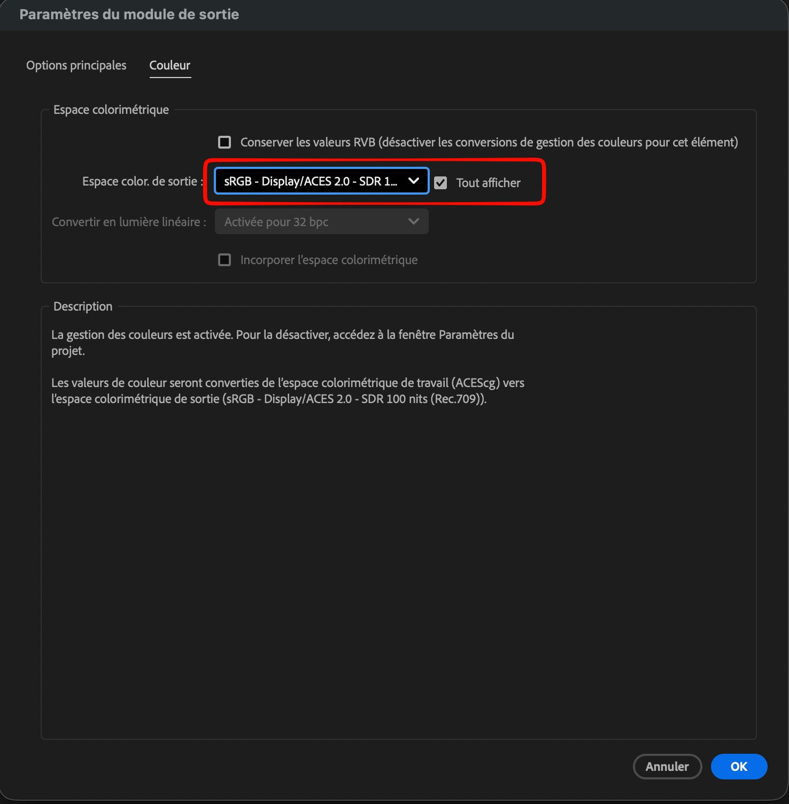

# Jour 3 – Éclairage, scène d’intérieur et compositing

## Objectifs du jour

- Comprendre l’éclairage trois points et savoir s’en affranchir.
- Maîtriser les rôles de la key light, de la fill light, de la rim light et du spot.
- Éclairer du métal et du verre.
- Importer une scène externe et créer une ambiance de nuit volumétrique.
- Passer le rendu dans After Effects sans perdre les couleurs.

## L’éclairage trois points

On s’entraîne sur la scène **ShaderBall** de Redshift, disponible dans l’Asset Browser.

L’éclairage trois points est **la base de la photo** et un excellent point de départ. Mais :

- Il est peu créatif : ne vous laissez pas enfermer dedans.
- Souvent, **deux lumières suffisent**, parfois une seule.
- Les tutoriels d’éclairage de **photographes et de chefs opérateurs** sont souvent meilleurs que ceux dédiés à la 3D : la lumière obéit aux mêmes règles.

**La key light (lumière principale)**

- Elle donne la **direction** de la lumière, l’**intention** de la scène et l’**ombre principale**.
- Le plus souvent à **45°** de l’axe de la caméra, placée en hauteur (mais toute hauteur peut fonctionner).
- En général une **petite Area Light** (lumière de zone), assez intense : petite source = ombres nettes.

**La fill light (lumière de débouchage)**

- Elle **débouche les ombres**, c’est-à-dire qu’elle les éclaircit.
- En général à **90°** de la key light, ou au-dessus de la scène.
- Une **grande Area Light** de faible intensité : grande source = lumière douce.
- Elle atténue les ombres sans les supprimer (sauf effet voulu).
- Elle peut parfois suffire seule. Une **Dome Light** seule joue le rôle d’une fill light.

**La rim light (lumière de contour)**

- Elle **découpe la silhouette** de l’objet et le détache du fond.
- Placée **derrière** l’objet.
- Dans l’onglet **Scène** (Scene) de la lumière, excluez le sol pour éviter une tache de lumière disgracieuse.

**Colorer les lumières**

- **Température de couleur** : key light chaude (orangée), fill light froide (bleutée). Un classique qui fonctionne toujours.
- Couleurs libres pour des ambiances plus créatives.

**Le spot**

- Il souligne une zone précise : un visage, un objet posé.
- Cône réduit avec beaucoup d’**adoucissement** (falloff) sur les bords.
- Astuce : dans le viewport, menu **Caméras \> Utiliser la caméra \> Objet sélectionné comme caméra** (Selected Object as Camera). Vous voyez « à travers » la lumière et la cadrez comme une caméra.

{: .w40}
*Le menu Caméras du viewport : « Objet sélectionné comme caméra » permet de viser avec une lumière. — Document d'origine*

Aide Maxon : [Redshift Light](https://help.maxon.net/c4d/s26/en-us/Content/_REDSHIFT_/html/Redshift_C4D_Light.html), [Dome Light](https://help.maxon.net/c4d/en-us/Content/_REDSHIFT_/html/Dome+Light.html).

## Le problème du métal et du verre

Le métal et le verre **reflètent leur environnement**. Sans environnement, un métal parfait reflète… du noir : on ne voit rien.

- Donnez-leur quelque chose à refléter : une HDRI, un décor, des panneaux lumineux.
- Utilisez des **plans qui n’apparaissent que dans les reflets** (invisibles à la caméra, réglage dans le tag Objet Redshift ou les options de visibilité).
- Avec le métal, on ne l’éclaire pas vraiment : on **sculpte ses reflets**, en plaçant des formes lumineuses là où l’on veut voir une ligne brillante.

## Projet : la scène du détective

**Importer et nettoyer la scène**

1. Téléchargez la scène **Detective** depuis BlenderKit et exportez-la en **USD** depuis Blender.
2. Importez l’USD dans Cinema 4D.
3. **Supprimez les nuls inutiles** : avec le filtre du Gestionnaire d’objets, sélectionnez tous les objets nuls, puis **Supprimer sans les enfants** (Delete Without Children).
4. **Recentrez les axes** : Outils \> Axe \> **Centrer l’axe sur** (Center Axis to). Après un import, les axes sont souvent loin des objets.

{: .w50}
*La scène importée depuis BlenderKit, avant nettoyage. — Document d'origine*

{: .w40}
*Outils \> Axe \> Centrer l’axe sur : recentrer l’axe de chaque objet. — Document d'origine*

**Créer une ambiance de nuit**

1. Supprimez les lumières déjà présentes.
2. Une **Dome Light** pour l’ambiance générale… ce n’est pas optimal.
3. Mieux : une **Area Light** placée **dans la fenêtre**. Elle éclaire la pièce comme la lumière venant de dehors ; la Dome Light devient inutile.
4. Derrière la fenêtre, un **plan avec un matériau lumineux** (RS Incandescent) affiche le paysage extérieur. Il n’apparaît qu’au rendu et **n’éclaire pas** : c’est l’Area Light qui fait le travail.
5. Une **fill light** près de la caméra débouche les ombres.
6. Un **spot** au niveau de la lampe de chevet.

**L’ambiance volumétrique**

Il manque l’essentiel : l’air qui accroche la lumière (poussière, brume).

- Ajoutez un **RS Environment** : il crée un brouillard volumétrique dans toute la scène. Aide Maxon : [Environment](https://help.maxon.net/c4d/en-us/Content/_REDSHIFT_/html/Environment.html).
- Mettez la contribution **Volume** à zéro sur les lumières qui ressortent trop dans le brouillard (souvent la fill light).
- Ajoutez un **Noise** dans le volume pour rendre la lumière volumétrique irrégulière, plus naturelle.

**Détails lumineux**

- Un **écran de télévision allumé** : RS Incandescent, ou un matériau avec **Émission** activée.

**Les Post-FX**

Le halo autour des hautes lumières vient de deux phénomènes réels :

- La **diffusion dans l’atmosphère** : déjà simulée par le RS Environment.
- Les **réflexions internes dans l’objectif** de la caméra : c’est le **bloom**, ajouté en post-traitement.

{: .w60}
*La scène du détective avant et après l’éclairage de nuit volumétrique. — Document d'origine*

## Passer dans After Effects en EXR ACES

Pour garder toute la dynamique de l’image et des couleurs identiques :

1. Dans Cinema 4D, rendez au format **OpenEXR 32 bits** (flottant).
2. Dans After Effects, ouvrez **Fichier › Paramètres du projet**, onglet **Couleur**, et réglez :
   - **Moteur de couleurs** : **OCIO color managed** ;
   - **Configuration OCIO** : **ACES 2.0 CG v4.0** ;
   - **Résolution** : **32 bits par couche (flottant)** ;
   - **Espace colorimétrique de travail** : **scene_linear: ACEScg** ;
   - **Espace colorimétrique de l’affichage** : **sRGB – Display/ACES 2.0 – SDR 100 nits (Rec.709)**.

   {: .w75}
   *Paramètres du projet, onglet Couleur : moteur OCIO, configuration ACES 2.0 CG v4.0, espace de travail ACEScg et affichage sRGB – Display/ACES 2.0 – SDR 100 nits (Rec.709). — Capture After Effects*

3. **Si ces réglages ne sont pas respectés, les couleurs ne correspondront pas.**
4. Pour un étalonnage « cinéma » rapide, utilisez **Red Giant Looks**.
5. **À l’export** : ajoutez la composition à la **file d’attente de rendu**, puis cliquez sur le lien bleu du **Module de sortie** pour ouvrir ses paramètres.

   {: .w90}
   *La file d’attente de rendu : un clic sur le lien du Module de sortie ouvre ses paramètres. — Capture After Effects*

6. Dans l’onglet **Couleur** du module de sortie, cochez **Tout afficher**, puis choisissez comme **Espace color. de sortie** : **sRGB – Display/ACES 2.0 – SDR 100 nits (Rec.709)**, la même transformation que l’affichage du projet. La description confirme la conversion : de l’espace de travail ACEScg vers sRGB – Display/ACES 2.0.

   {: .w60}
   *Paramètres du module de sortie, onglet Couleur : espace de sortie sRGB – Display/ACES 2.0 – SDR 100 nits (Rec.709), avec Tout afficher coché. — Capture After Effects*

## Points de vigilance

- Une seule key light, cohérente avec la scène.
- Métal et verre : prévoyez toujours quelque chose à refléter.
- Brouillard volumétrique : retirez le volume des lumières trop présentes.
- After Effects : EXR 32 bits + projet OCIO en ACES 2.0 (travail ACEScg), sinon les couleurs sont fausses.
